### ЛАБОРАТОРНАЯ РАБОТА №3

Студент: Любовицкий Никита Николаевич

---

## 1. Цель работы

Научиться работать в Wireshark: захватывать трафик, пользоваться фильтрами и статистикой, а потом разбирать по полям заголовки Ethernet, IP, ICMP, TCP, UDP и ARP.

**Используемое ПО:** Windows 11, Wireshark 4.6.9, Wi-Fi-адаптер Intel Wi-Fi 6 AX201. Адрес моей машины — 100.70.45.15, MAC — 6c:f6:da:44:47:42.

## 2. Задания 1–2

*1. Изучить краткие теоретические сведения по возможностям и приёмам работы с Wireshark.*

**Ответ:** Изучил.

*2. Изучить типы фильтрации трафика, правила построения фильтров и приёмы статистической обработки.*

**Ответ:** Изучил. Фильтр захвата задаётся до записи и сразу отбрасывает лишнее, а фильтр отображения работает по готовому файлу и просто прячет пакеты.

В фильтре отображения пишут протокол (ip, tcp, arp) или поле через точку: ip.addr, tcp.port, icmp.type. Из статистики чаще всего нужны Summary, Protocol Hierarchy, Packet Lengths, I/O Graph и Flow Graph — проценты там считаются от всего файла.

## 3. Задание 3. Захват загрузки страницы bstu.by

*3. Запустить Wireshark на захват, загрузить страницу bstu.by, остановить и сохранить захват. Определить соотношение протоколов, скорости, размеры пакетов и загрузку полосы.*

| Показатель           | Значение                    | Комментарий              |
| -------------------- | --------------------------- | ------------------------ |
| Всего пакетов        | 3215                        | один сеанс загрузки      |
| Суммарный объём      | 3 398 744 Б                 | около 3.4 МБ             |
| Кадр min / avg / max | 46 / 1057.15 / 36454 Б      | от ACK до крупных блоков |
| Скорость             | 100.7 пак/с и 106 479.8 Б/с | ≈851.8 кбит/с            |
| Загрузка канала      | 0.5899 %                    | при 144.4 Мбит/с         |

| Протокол | Пакетов | % пакетов | % байтов |
|---|---|---|---|
| TLS | 1486 | 46.2 | 84.2 |
| TCP | 3108 | 96.7 | 1.9 |
| UDP | 98 | 3.05 | 0.02 |
| DNS | 16 | 0.5 | 0.03 |
| HTTP | 8 | 0.25 | 0.05 |

Больше всего байтов — 84.2 % — у TLS, потому что сайт открывался по HTTPS. TCP занимает 96.7 % пакетов: через него идёт весь обмен. UDP и DNS — служебные запросы, а открытого HTTP всего 8 пакетов: редирект и robots.txt. Канал при этом почти свободен, так что страница грузилась не из-за полосы, а из-за задержек.

Средний кадр 1057.15 Б

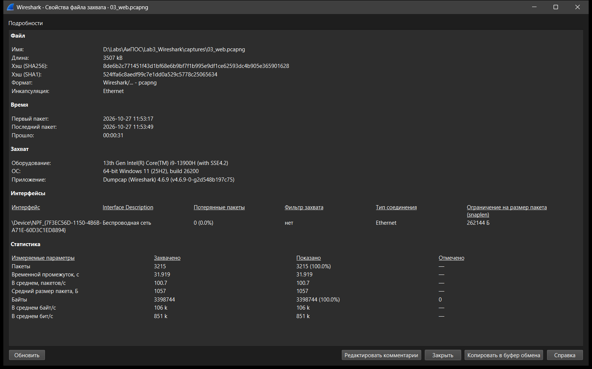

*Рисунок 1 — Свойства файла: 3215 пакетов, 31.9 секунды, потерь нет.*

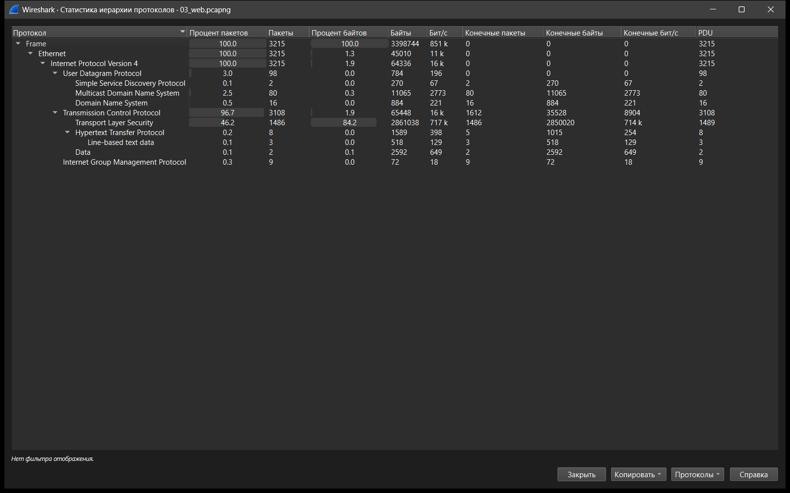

*Рисунок 2 — Иерархия протоколов: TLS — 46.2 % пакетов и 84.2 % байтов.*

*Рисунок 3 — Длины пакетов: коротких кадров много, объём дают крупные.*

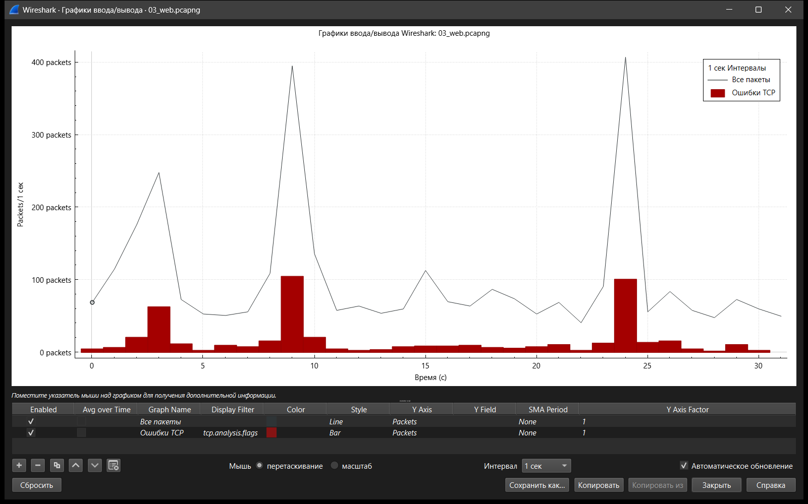

*Рисунок 4 — График ввода-вывода: по всплеску на каждую загрузку страницы.*

## 4. Задание 4. Фильтр ip и разбор заголовка IPv4

*4. Отфильтровать IP-пакеты, определить соотношение протоколов внутри IP и размеры пакетов. На примере любого пакета показать структуру Ethernet и IP и объяснить поля.*

Внутри IP: TCP 3108 пакетов (96.67 %), UDP 98 (3.05 %), IGMP 9 (0.28 %), ICMP нет. 

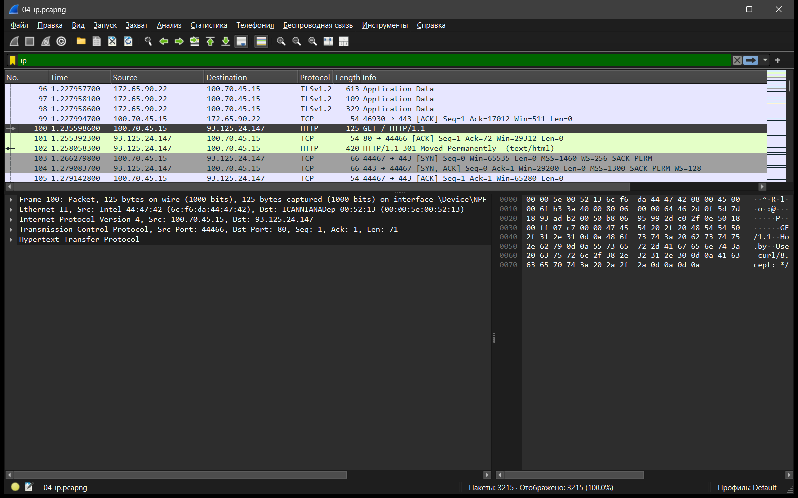

*Рисунок 5 — Список пакетов с фильтром ip: 3215 из 3215.*

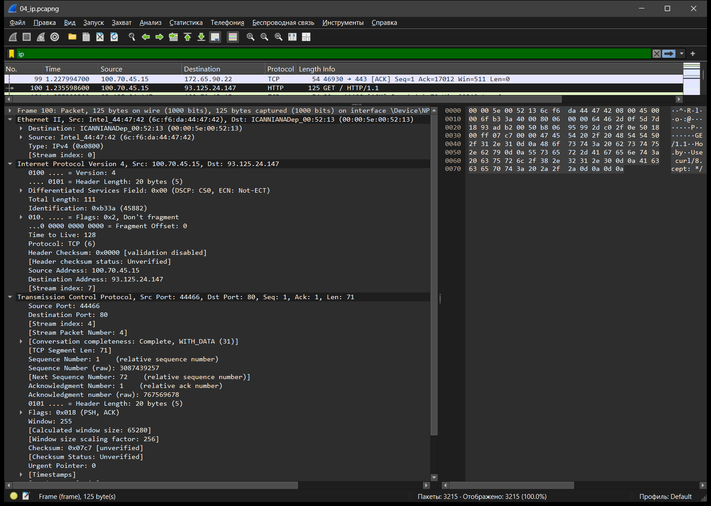

*Рисунок 6 — Кадр 100: Ethernet, IPv4 и TCP с портом 80.*

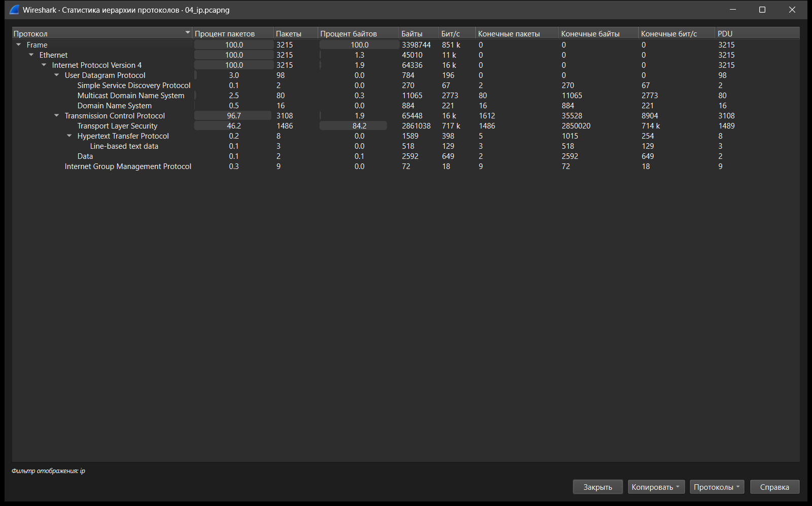

*Рисунок 7 — Иерархия протоколов: состав тот же, что в задании 3.*

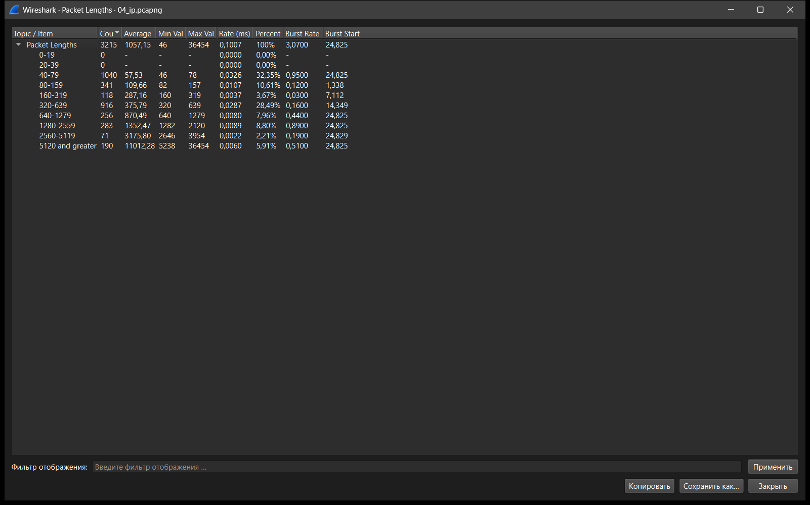

*Рисунок 8 — Длины пакетов: основная масса до 1500 байт и несколько крупных.*

## 5. Задание 5. Анализ ICMP при выполнении ping

*5. Запустить захват, выполнить ping для IP-адреса соседней станции, сохранить результат, отфильтровать пакеты ping, объяснить результат и составить диаграмму взаимодействия машин.*

В запросе тип 8, в ответе 0. Identifier везде 1, а Sequence идёт подряд: 199, 200, 201, 202 — по этим двум полям ping и находит свою пару. Данные в ответе те же 32 байта, что и в запросе.

Время ответа по Wireshark получилось от 0.05 до 0.20 мс

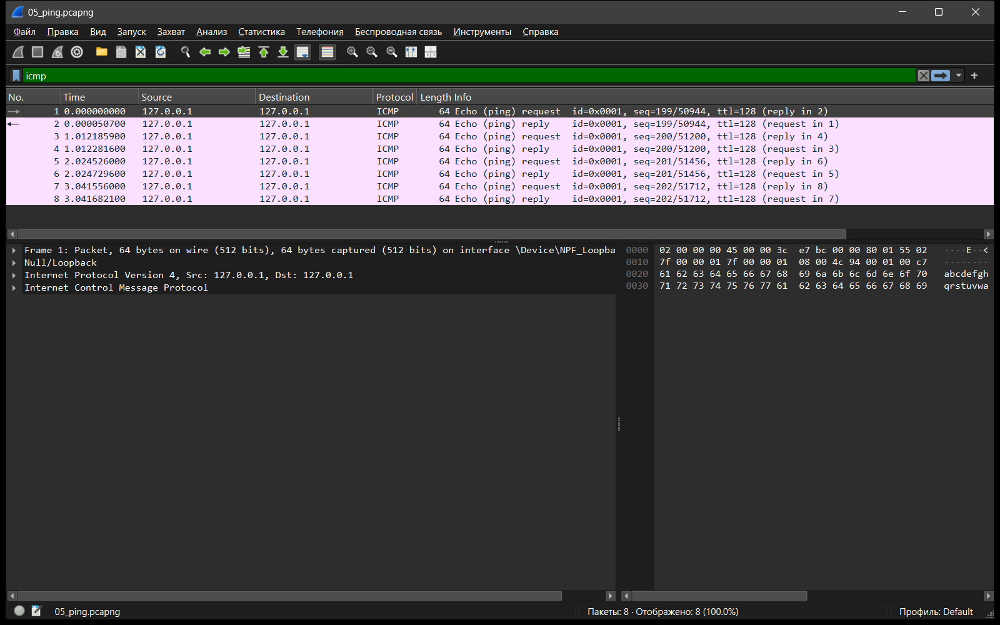

*Рисунок 9 — Список пакетов ping: четыре запроса и четыре ответа.*

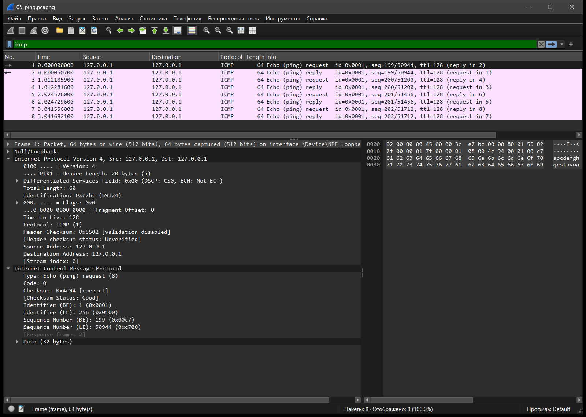

*Рисунок 10 — Кадр 1: тип 8, код 0, идентификатор 1, номер 199.*

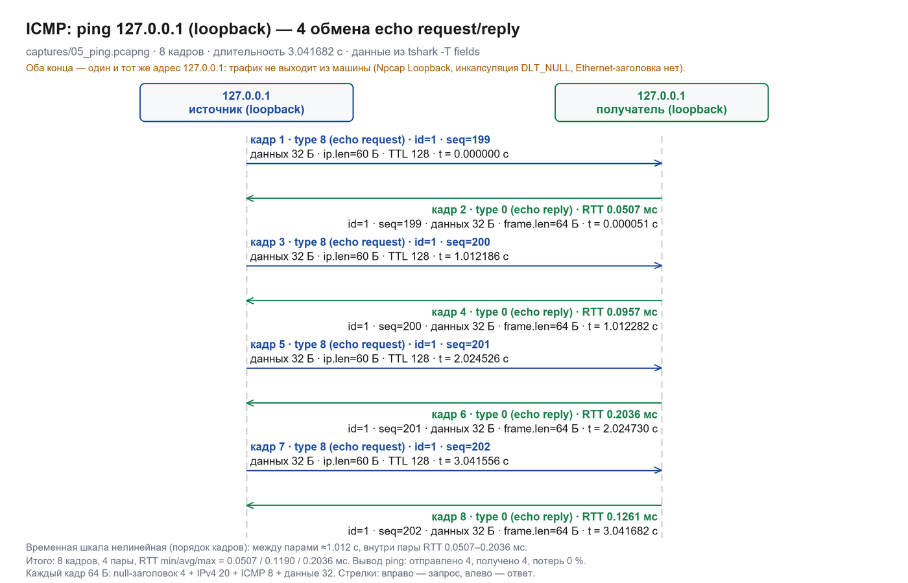

*Рисунок 11 — Диаграмма обмена: четыре пары запрос-ответ.*

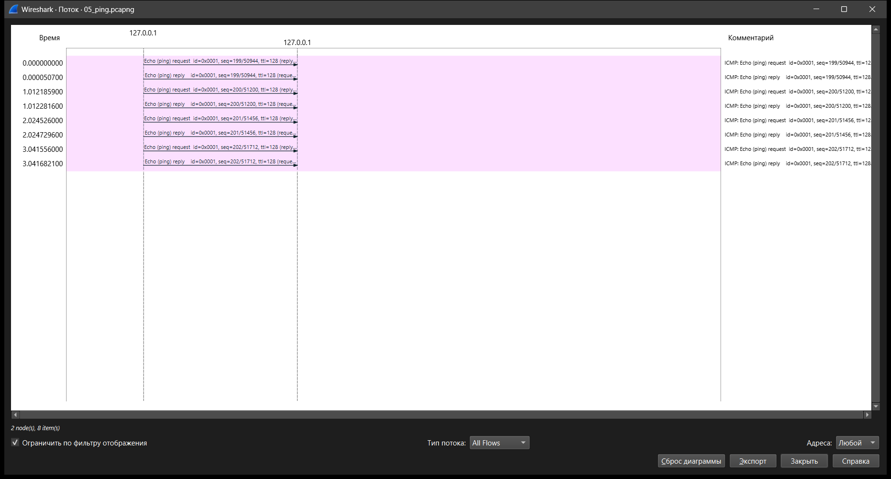

*Рисунок 12 — График потока: два узла и восемь пакетов.*

## 6. Задание 6. Анализ TCP-соединения

*6. Запустить TCP-сервер и клиент из предыдущей лабораторной, сохранить результат и отфильтровать пакеты сеанса. На примере сегмента разобрать заголовок TCP и составить диаграмму взаимодействия.*

| Кадр | Что это | Данные, Б |
|---|---|---|
| 1–3 | SYN, SYN-ACK, ACK | 0 |
| 4 | данные клиента | 34 |
| 5 | подтверждение | 0 |
| 6 | данные сервера | 46 |
| 7 | подтверждение | 0 |
| 8 | RST | 0 |

Данные ушли двумя сегментами: 34 байта от клиента и 46 байт от сервера, на каждый пришло подтверждение. Закончилось всё пакетом RST: я закрыл окно клиента, программа завершилась, и Windows сбросила соединение. Данные к этому моменту уже были подтверждены, так что ничего не потерялось. В кадре 4 стоят флаги PSH и ACK, окно 255, а с учётом масштаба — 65280 байт, контрольная сумма 0x06a6 правильная.

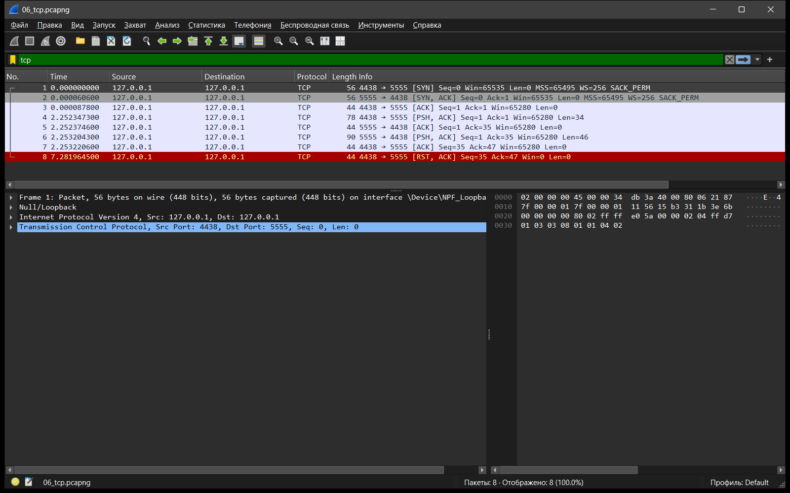

*Рисунок 13 — Список сегментов: от SYN до RST.*

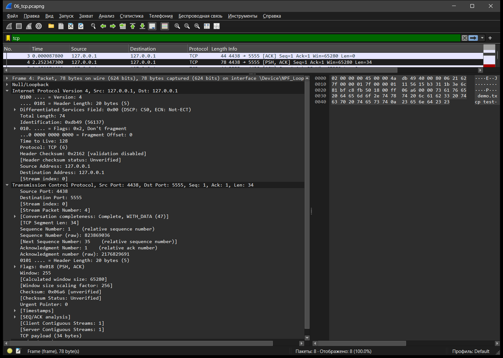

*Рисунок 14 — Кадр 4: порты 4438 → 5555, флаги PSH и ACK, окно 255.*

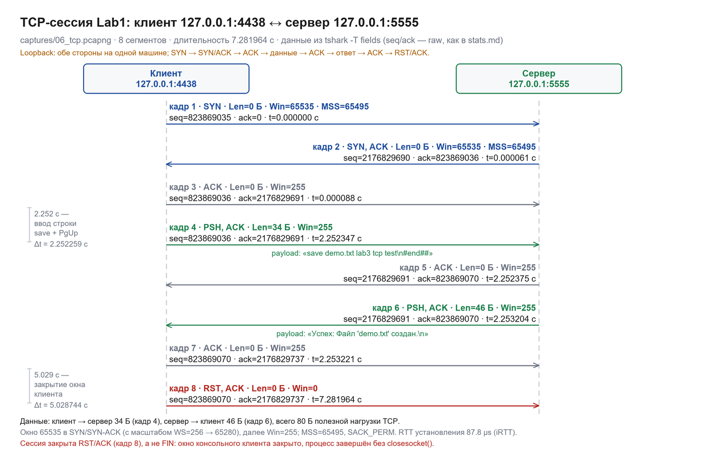

*Рисунок 15 — Диаграмма сессии: рукопожатие, пауза, данные и RST.*

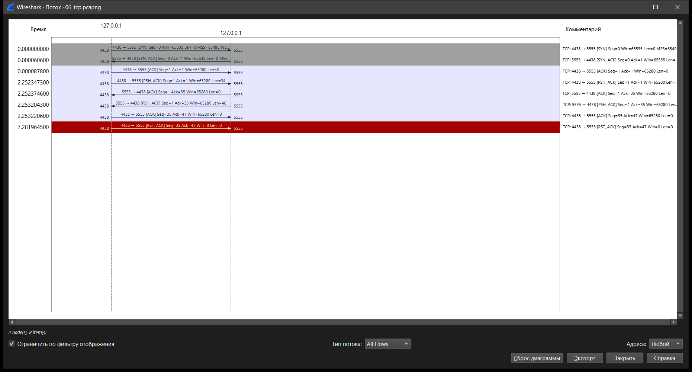

*Рисунок 16 — График потока: восемь сегментов между клиентом и сервером.*

## 7. Задание 7. Анализ UDP-обмена

*7. Запустить UDP-сервер и клиент из предыдущей лабораторной, сохранить результат и отфильтровать пакеты сеанса. На примере датаграммы разобрать заголовок UDP.*

| Кадр | Откуда → куда | Длина | Текст |
|---|---|---|---|
| 1 | клиент → сервер | 22 Б | save test.txt |
| 2 | клиент → сервер | 31 Б | hello from lab3 #end## |
| 3 | сервер → клиент | 34 Б | OK: file test.txt created |

Длина 22, 31 и 34 байта — это 8 байт заголовка UDP плюс 14, 23 и 26 байт текста. Порт клиента 60780, сервера 666, контрольные суммы Wireshark проверил без ошибок. Клиент отправил две датаграммы, а сервер ответил только на вторую: он копит строки до маркера #end##. Соединения и подтверждений здесь нет, поэтому ответ сервера — единственный признак, что всё дошло.

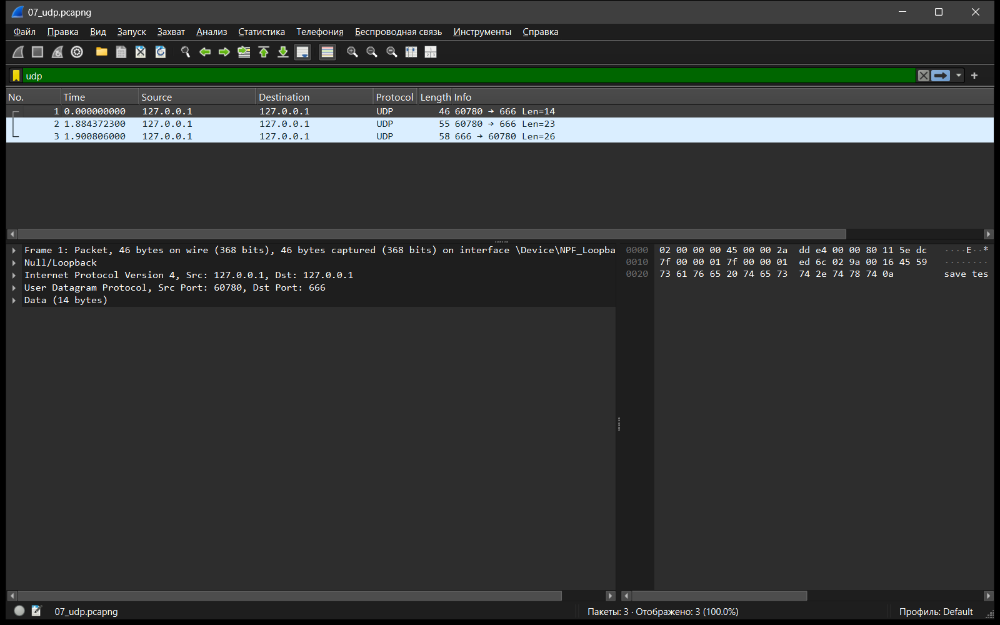

*Рисунок 17 — Список датаграмм: две от клиента и одна от сервера.*

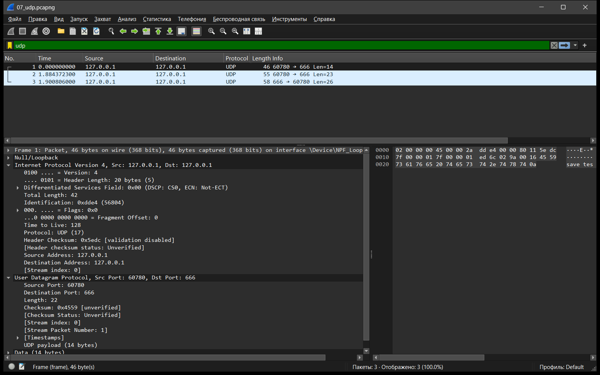

*Рисунок 18 — Датаграмма 1: порты 60780 → 666, длина 22 байта, текст save test.txt.*

## 8. Задание 8. Анализ протокола ARP

*8. Проанализировать ARP по примеру из методических указаний: рассмотреть запрос и ответ, отметить поля Ethernet и ARP и объяснить их значения.*

| Кто ответил | MAC в ответе | Комментарий |
|---|---|---|
| 100.70.45.2 | 00:00:5e:00:52:13 | MAC шлюза, proxy ARP |
| 100.70.45.200 | 00:00:5e:00:52:13 | тоже шлюз, proxy ARP |
| 100.70.45.3 | 8a:d7:02:aa:ff:ce | настоящий хост |
| .1, .100, .254 | — | ответа не было |

Запрос широковещательный: получатель ff:ff:ff:ff:ff:ff, тип 0x0806, opcode 1. Внутри мой MAC 6c:f6:da:44:47:42 и адрес 100.70.45.15, MAC получателя нулевой, потому что его ещё не знают. Весит запрос 42 байта.

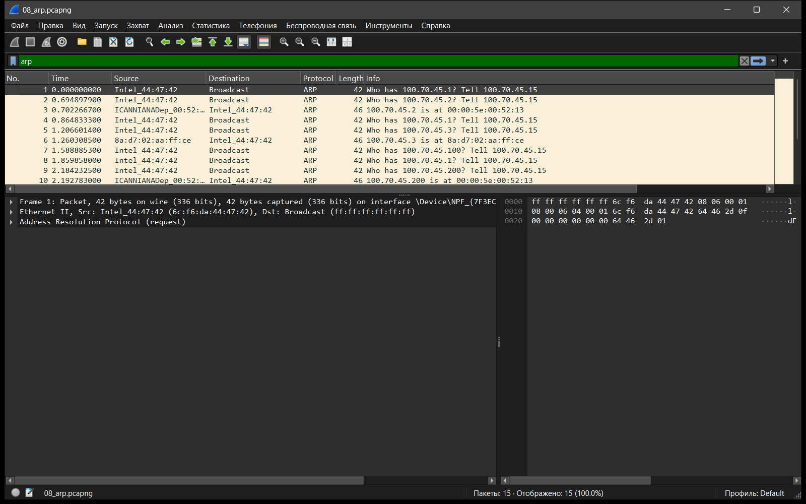

*Рисунок 19 — Список ARP-пакетов: 15 кадров, в Info видно «Who has …».*

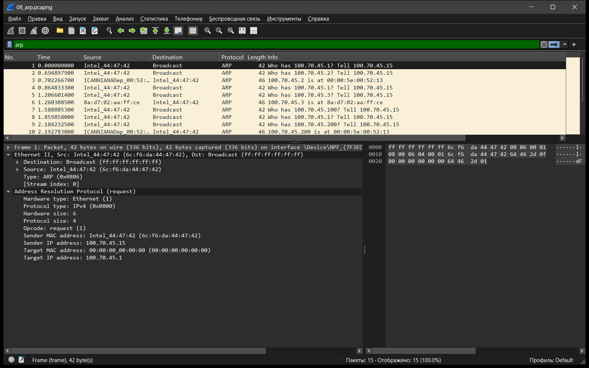

*Рисунок 20 — ARP-запрос: широковещательный кадр, opcode 1, MAC получателя нулевой.*

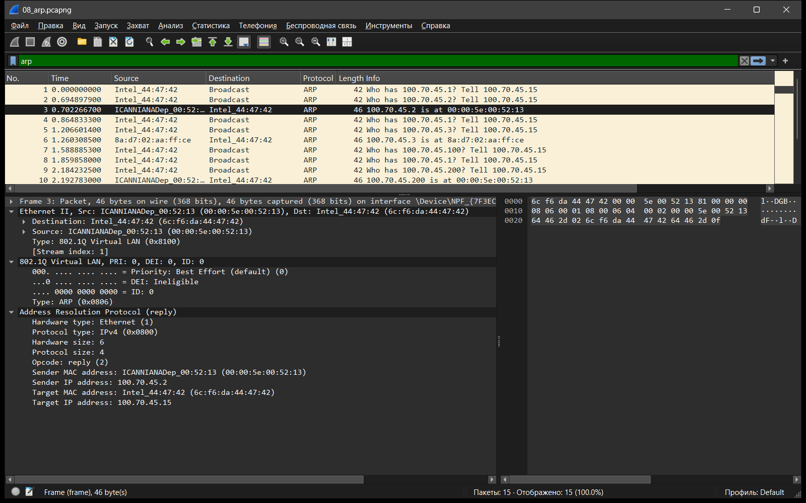

*Рисунок 21 — ARP-ответ: opcode 2, отправитель — шлюз, в кадре тег 802.1Q.*

## 9. Вывод

В ходе работы я научился захватывать трафик в Wireshark и разбирать его по уровням. 

