# Лабораторная работа №3

**Студент:** Олексюк И.В., группа ИИ-28

**Описание:** В ходе выполнения лабораторной работы были изучены теоретические сведения по возможностям и приёмам работы с программой Wireshark. Изученный материал был применён на практике для анализа различных сетевых протоколов.

## Захват загрузки страницы и общая статистика

Захват вёлся на интерфейсе «Беспроводная сеть» без фильтра захвата. В браузере открывалась страница `http://bstu.by`.

### Общие показатели

| Параметр | Значение |
|---|---|
| Количество пакетов | **1610** |
| Длительность захвата | **84.297 с** (00:01:24) |
| Средняя скорость кадров | **19.1 пак/с** |
| Средний размер пакета | **1794 байт** |
| Объём захвата | **2 888 455 байт** (2943 кБ) |
| Средняя скорость | **34 КБ/с (274 кбит/с)** |
| Минимальный размер кадра | **46 байт** |
| Максимальный размер кадра | **63754 байт** |

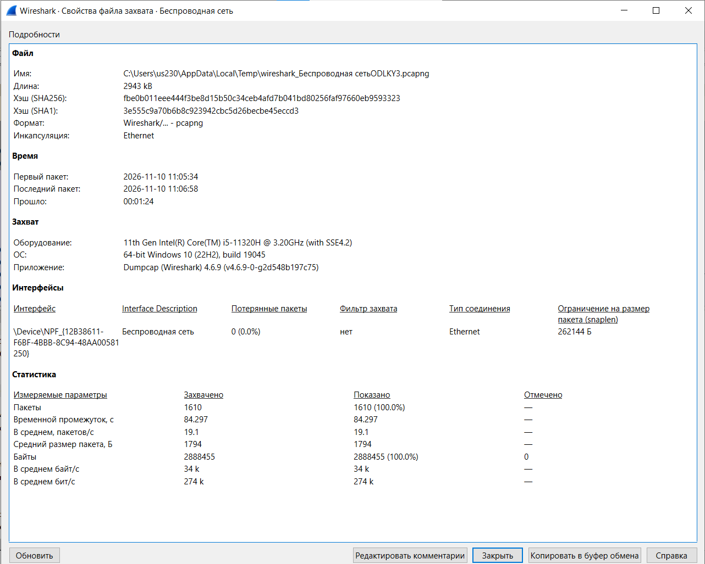
*Сводка по захвату: 1610 пакетов, 84.297 с*

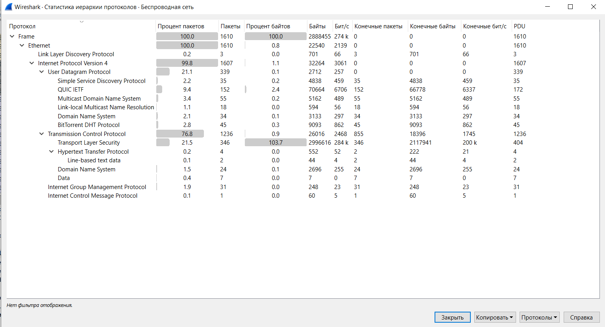
*Protocol Hierarchy: доли протоколов по пакетам и байтам*

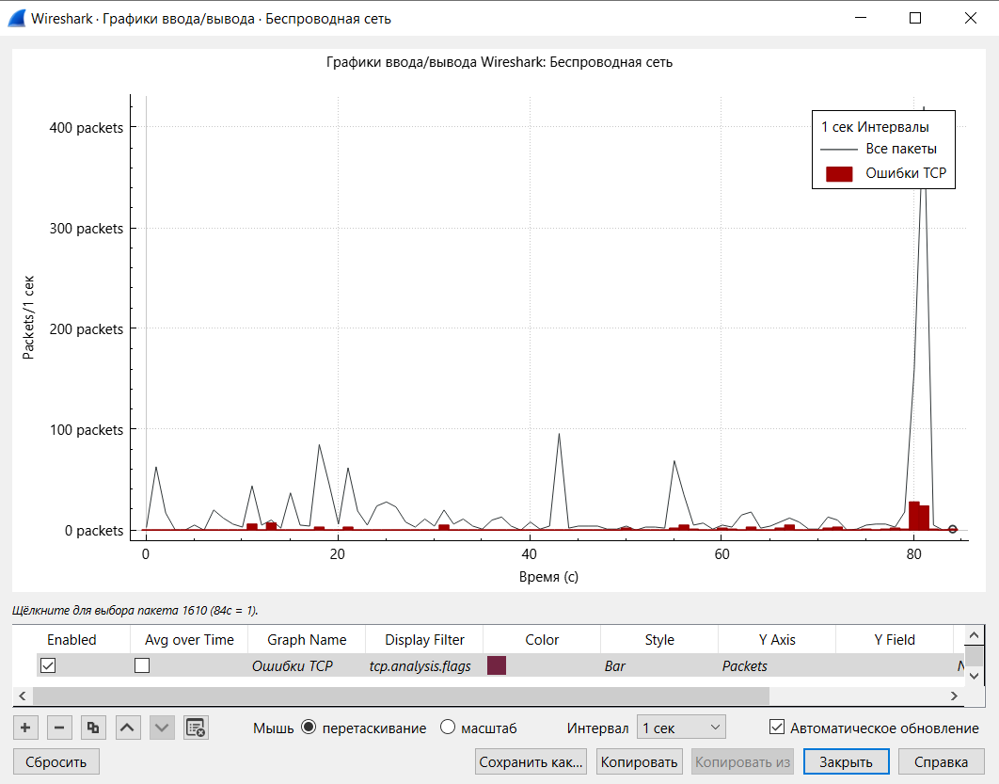
*График интенсивности трафика*

Основную часть трафика составляют IPv4 (99.8% пакетов) и TCP (76.8% пакетов). Значительная доля TLS (21.5%) объясняется тем, что современные сайты загружаются по HTTPS. Протокол UDP занимает 21.1% (QUIC, mDNS, SSDP, BitTorrent). 

Загрузка канала считалась так: 274 кбит/с / 100 Мбит/с × 100 % ≈ **0.27 %**.

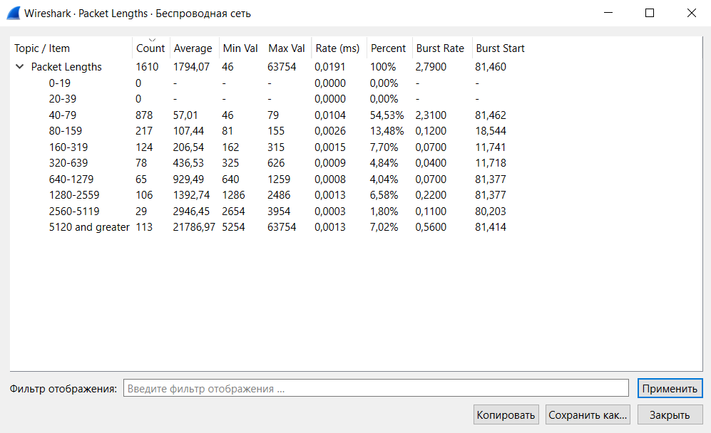
*Распределение пакетов по длине*

## IP-пакеты, Ethernet и IP

В захвате был применён фильтр отображения `ip`.

### Статистика по IP-пакетам

| Параметр | Значение |
|---|---|
| Количество пакетов | **1607** |
| IPv4 (от общего числа) | **100%** |
| TCP | **76.9%** |
| UDP | **21.1%** |
| TLS | **21.5%** |

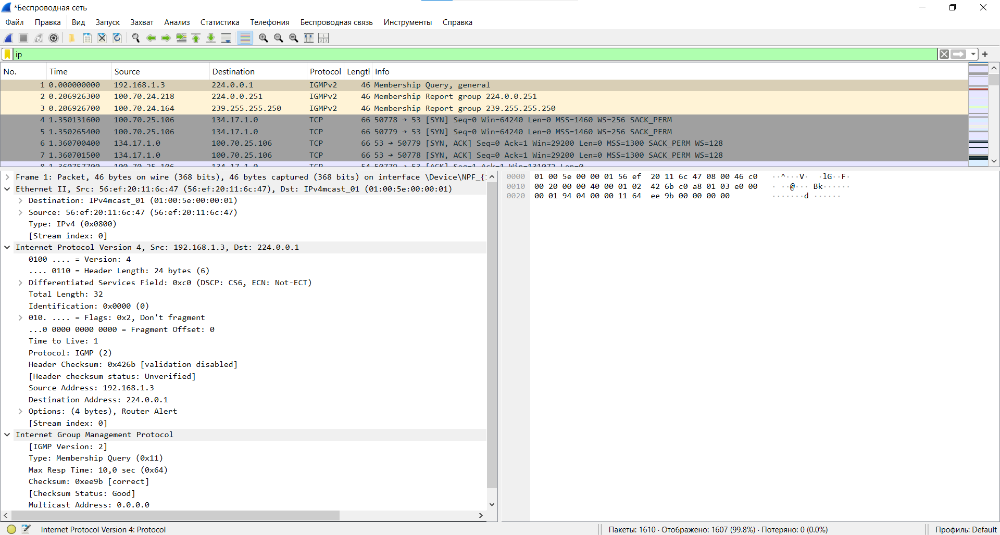
*Список IP-пакетов*

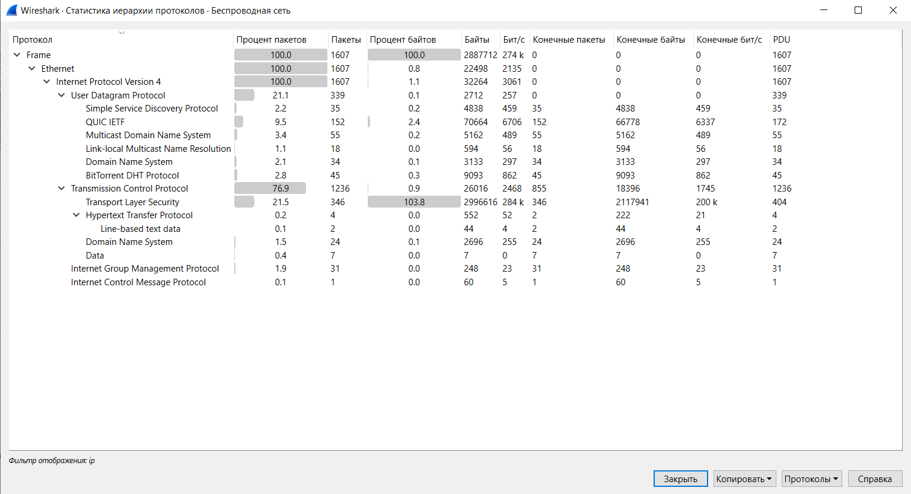
*Protocol Hierarchy с фильтром ip*

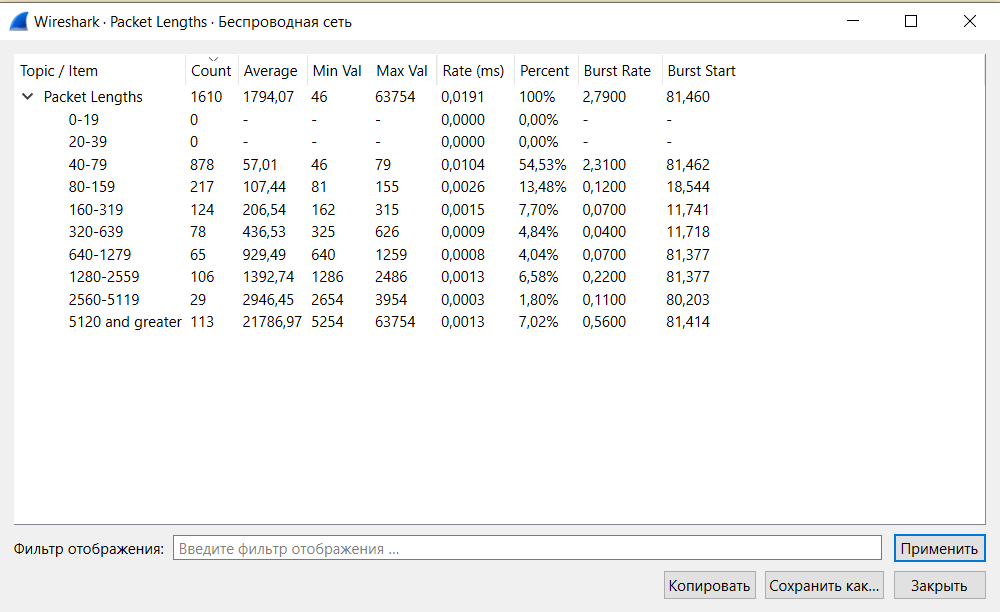
*Packet Lengths с фильтром ip*

### Структура Ethernet и IP

**Ethernet II:**
| Поле | Значение | Что означает |
|---|---|---|
| Destination | `01:00:5e:00:00:01` | MAC-адрес получателя (Multicast) |
| Source | `56:ef:20:11:6c:47` | MAC-адрес Wi-Fi-адаптера |
| Type | `0x0800` | В кадре лежит IPv4-пакет |

**IPv4:**
| Поле | Значение | Что означает |
|---|---|---|
| Version | 4 | Протокол IPv4 |
| Header Length | 24 байта | Длина заголовка (20 байт + 4 байта опций) |
| Total Length | 32 | Общая длина IP-пакета |
| Time to Live | 1 | Время жизни пакета |
| Protocol | 2 (IGMP) | Протокол внутри IP |
| Source Address | `192.168.1.3` | Адрес отправителя |
| Destination Address | `224.0.0.1` | Адрес получателя (Multicast) |

## Ping и протокол ICMP

Захват выполнялся на интерфейсе **Беспроводная сеть** с фильтром захвата `icmp`. Была выполнена команда `ping` до шлюза.

| № | Время, с | Источник | Получатель | Тип | Seq | Длина |
|---|---|---|---|---|---|---|
| 903 | 80.722863 | 100.70.25.106 | 100.70.0.1 | Echo request (8) | 5 | 74 |
| 904 | 80.731692 | 100.70.0.1 | 100.70.25.106 | Echo reply (0) | 5 | 74 |
| 910 | 81.736339 | 100.70.25.106 | 100.70.0.1 | Echo request (8) | 6 | 74 |
| 911 | 81.778778 | 100.70.0.1 | 100.70.25.106 | Echo reply (0) | 6 | 74 |

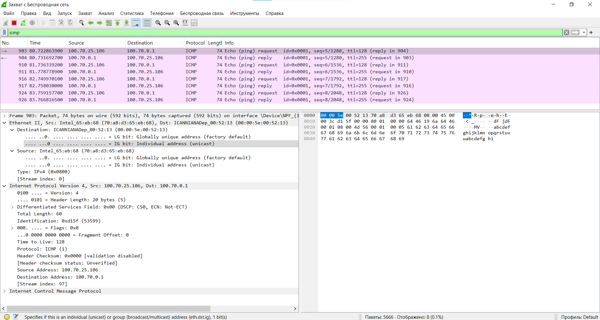
*Список ICMP-пакетов*

*Диаграмма Flow Graph для ICMP*

| Поле | Значение | Что означает |
|---|---|---|
| Type | 8 | Echo request (запрос ping) |
| Code | 0 | Для echo-запросов всегда 0 |
| Identifier | 1 | Идентификатор запроса |
| Sequence Number | 5 | Номер запроса (в ответе тот же) |
| Data | 32 байта | Заполнитель `abcdefghijklmnopqrstuvwabcdefghi` |

**Вывод:** Отправлено 4 пакета, получено 4, потерь 0%. Время ответа (RTT) составляет доли миллисекунды, что говорит о стабильном соединении.

## TCP-сервер и TCP-клиент

Захват вёлся на интерфейсе **Loopback** с фильтром `tcp.port == 666`. В клиенте была отправлена строка `create file text 123` и нажата клавиша **Home**.

| № | Флаги | Len | Info |
|---|---|---|---|
| 350 | RST, ACK | 0 | 666 → 63277 (предыдущее соединение было сброшено) |
| 351 | SYN | 0 | 61528 → 666 |
| 352 | SYN, ACK | 0 | 666 → 61528 |
| 353 | ACK | 0 | 61528 → 666 |
| 354 | PSH, ACK | 43 | Клиент отправил команду |
| 355 | ACK | 0 | 666 → 61528 (подтверждение) |
| 398 | PSH, ACK | 41 | 666 → 61528 (ответ сервера) |

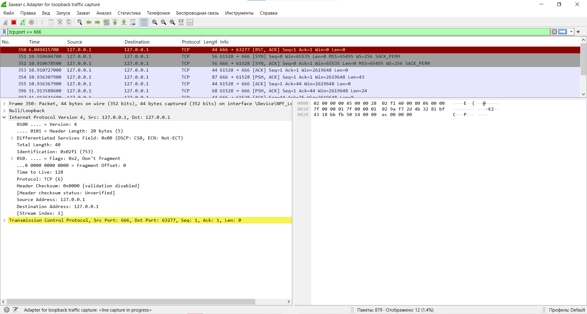
*Список TCP-пакетов*

*Диаграмма Flow Graph для TCP*

| Поле | Значение | Что означает |
|---|---|---|
| Source Port | 666 | Порт сервера |
| Destination Port | 63277 (или 61528) | Порт клиента |
| Sequence Number | 1 | Номер первого байта данных |
| Acknowledgment Number | 1 | Номер байта, который ожидает принять отправитель |
| Flags | `0x018` (PSH, ACK) | Есть данные (PSH) и подтверждение (ACK) |
| Window | 2619648 | Размер окна |
| Length | 43 / 41 | Длина полезной нагрузки |

## UDP-сервер и UDP-клиент

Захват вёлся на интерфейсе **Loopback** с фильтром `udp.port == 666`.

| № | Время, с | Источник | Получатель | Длина UDP | Payload |
|---|---|---|---|---|---|
| 2562 | 309.089377 | 127.0.0.1:50439 | 127.0.0.1:666 | 19 | `create file text 123` |
| 2563 | 309.092663 | 127.0.0.1:666 | 127.0.0.1:50439 | 38 | Ответ сервера |

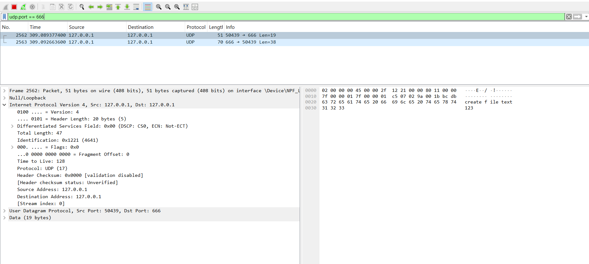
*Список UDP-пакетов*

*Диаграмма Flow Graph для UDP*

| Поле | Значение | Что означает |
|---|---|---|
| Source Port | 50439 | Порт клиента |
| Destination Port | 666 | Порт сервера |
| Length | 19 | 8 байт заголовка + 11 байт данных |
| Checksum | `0x0000` | Контрольная сумма (Wireshark не проверяет) |

## Протокол ARP

ARP (Address Resolution Protocol, RFC 826) нужен, чтобы по IP-адресу узнать MAC-адрес соседа в локальной сети. 

| № | Opcode | Sender MAC | Sender IP | Target MAC | Target IP | Ethernet Destination |
|---|---|---|---|---|---|---|
| 4144 | request (1) | `70:a8:d3:65:eb:68` | 100.70.25.106 | `00:00:00:00:00:00` | 100.70.0.1 | `ff:ff:ff:ff:ff:ff` |
| 4163 | reply (2) | `00:00:5e:00:52:13` | 100.70.0.1 | `70:a8:d3:65:eb:68` | 100.70.25.106 | `70:a8:d3:65:eb:68` |

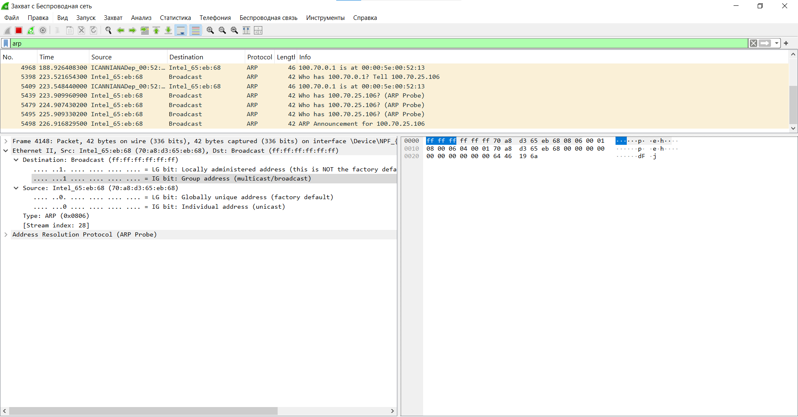
*Список ARP-пакетов*

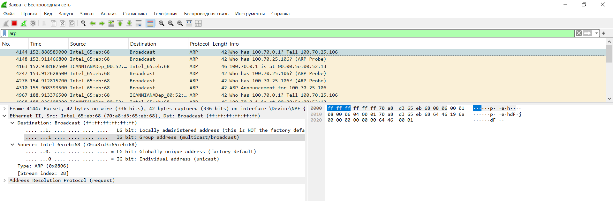
*ARP-запрос (request)*

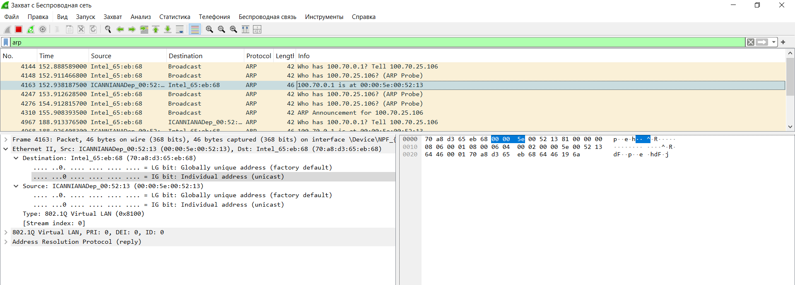
*ARP-ответ (reply)*

| Поле | Значение | Что означает |
|---|---|---|
| Hardware type | 1 | Ethernet |
| Protocol type | `0x0800` | IPv4 |
| Opcode | 1 | Request (у ответа будет 2) |
| Sender MAC / IP | `70:a8:d3:65:eb:68` / 100.70.25.106 | Кто спрашивает |
| Target MAC | `00:00:00:00:00:00` | Пока неизвестен, поэтому нули |
| Target IP | 100.70.0.1 | Чей MAC ищут |
