# Лабораторная работа №3

Студент: Степанюк Артём Сергеевич

Описание: В ходе выполнения лабораторной работы были изучены теоретические сведения по возможностям, приёмам работы с программой Wireshark. Изученный материал был применён на практике.

## Захват загрузки страницы и общая статистика

Захват вёлся на интерфейсе «Беспроводная сеть» без фильтра захвата. В браузере открывалась страница `http://bstu.by` — сервер отвечает `301` и перенаправляет на HTTPS, поэтому в захвате есть и HTTP, и TLS.

### Общие показатели

| Параметр | Значение |
|---|---|
| Количество пакетов | 631 |
| Длительность захвата | 17,437 с |
| Средняя скорость кадров | 36,2 пак/с |
| Средний размер пакета | 411 байт |
| Объём захвата | 259 121 байт |
| Средняя скорость | 14 КБ/с (118 кбит/с) |
| Минимальный размер кадра | 42 байта (ARP) |
| Максимальный размер кадра | 1933 байта (TLS Client Hello) |

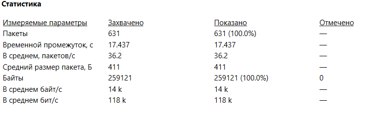

*Сводка по захвату: 631 пакет, 17,437 с, 36,2 пак/с, средний размер 411 байт*

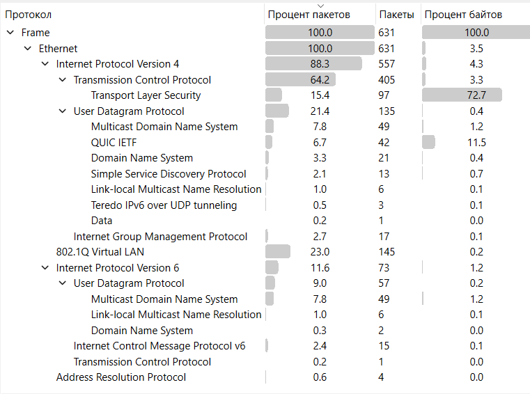

*Protocol Hierarchy: доли протоколов по пакетам и байтам*

Основную часть трафика составляют IPv4 (88,3 % пакетов) и TCP (64,2 %). Большая доля TLS объясняется тем, что страница загружается по HTTPS. Заметную часть занимает UDP (21,4 %) — это mDNS, QUIC, DNS и SSDP, то есть в основном служебный трафик Windows и браузера. Также присутствуют IPv6 (11,6 %), IGMP (2,7 %) и ARP (0,6 %).

Проценты в Protocol Hierarchy считаются по вложенным протоколам, поэтому в сумме они дают больше 100 %: например, TLS входит в TCP, а TCP — в IPv4.

Минимальные и максимальные кадры:

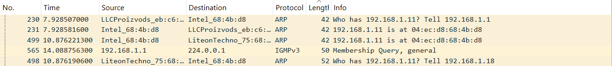

*Пакеты минимального размера — ARP по 42 байта*

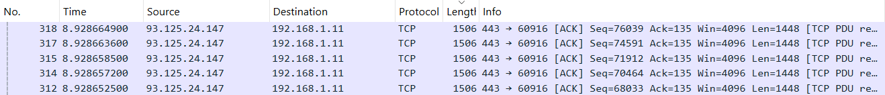

*Крупные TCP-сегменты по 1506 байт; максимальный кадр в захвате — 1933 байта (TLS Client Hello)*

Загрузка канала считалась так: 118 кбит/с / 650 Мбит/с × 100 % ≈ **0,02 %**.

## IP-пакеты, Ethernet и IP

В `task3.pcapng` был применён фильтр отображения `ip`, после чего отфильтрованные пакеты сохранены через **File → Export Specified Packets → Displayed** в файл `task4.pcapng`. Получилось 557 пакетов.

### Статистика по IP-пакетам

| Параметр | Значение |
|---|---|
| Количество пакетов | 557 |
| Длительность | 17,437 с |
| Средняя скорость кадров | 31,9 пак/с |
| Средний размер пакета | 450 байт |
| Объём | 250 809 байт |
| Средняя скорость | 14 КБ/с (115 кбит/с) |
| Минимальный размер | 50 байт (IGMP Membership Query) |
| Максимальный размер | 1933 байта (TLS Client Hello) |

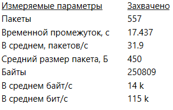

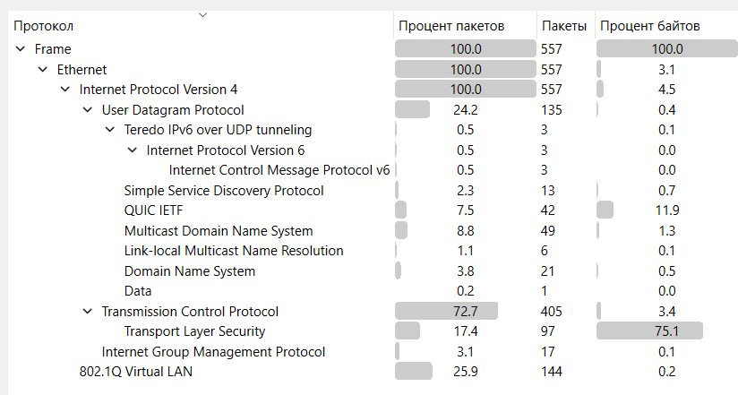

IPv4 - 100 %, TCP - 72,7 %, UDP - 24,2 %, TLS - 17,4 %, QUIC - 7,5 %, IGMP - 3,1 %. Отдельной строкой идёт 802.1Q VLAN - 25,9 %. Это не ошибка: 144 входящих кадра от роутера пришли с тегом VLAN 0, Wireshark показывает такой кадр как Ethernet → 802.1Q → IPv4. На статистику IP это не влияет, потому что IP-пакет внутри тега всё равно учитывается.

Минимальные и максимальные пакеты:

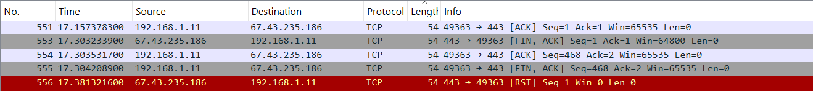

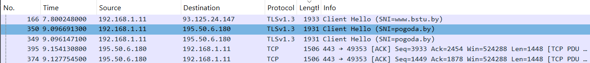

### Структура Ethernet и IP

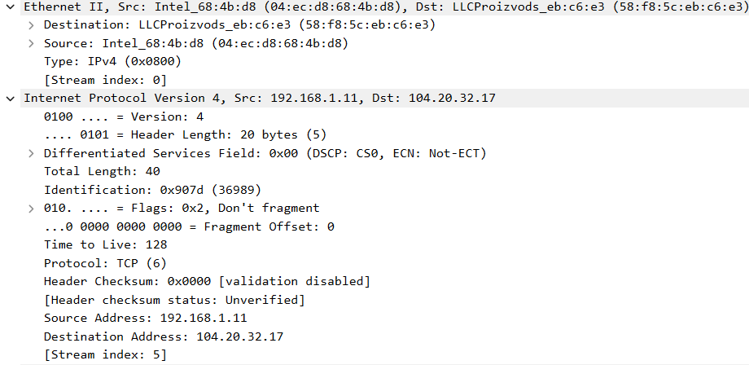

**Ethernet II:**

| Поле | Значение | Что означает |
|---|---|---|
| Destination | `58:f8:5c:eb:c6:e3` | MAC-адрес шлюза (роутера), которому отправлен кадр |
| Source | `04:ec:d8:68:4b:d8` | MAC-адрес Wi-Fi-адаптера машины |
| Type | `0x0800` | В кадре лежит IPv4-пакет |

**IPv4:**

| Поле | Значение | Что означает |
|---|---|---|
| Version | 4 | Протокол IPv4 |
| Header Length | 20 байт (5) | Длина заголовка 5 × 4 = 20 байт, опций нет |
| Differentiated Services | `0x00` | Обычный трафик, без приоритета |
| Total Length | 40 | Общая длина IP-пакета: 20 байт заголовка + 20 байт TCP |
| Identification | `0x907d` | Идентификатор пакета для сборки фрагментов |
| Flags | `0x2`, Don't fragment | Пакет нельзя фрагментировать |
| Fragment Offset | 0 | Пакет не является фрагментом |
| Time to Live | 128 | Начальное TTL; 128 типично для Windows |
| Protocol | 6 (TCP) | Внутри IP лежит TCP |
| Header Checksum | `0x0000` | Контрольная сумма не проверяется; вероятно, работает checksum offload на сетевой карте |
| Source Address | `192.168.1.11` | Адрес отправителя |
| Destination Address | `104.20.32.17` | Адрес получателя — внешний ресурс страницы |

Длина 40 байт = 20 (IP) + 20 (TCP), то есть это TCP-пакет без данных, скорее всего обычный ACK. TTL 128 и Protocol 6 подтверждают, что пакет отправлен с Windows и содержит TCP.

## Ping и протокол ICMP

В качестве второго хоста использован loopback-интерфейс `127.0.0.1`. Захват выполнялся на интерфейсе **Adapter for loopback traffic capture** с фильтром захвата `icmp and host 127.0.0.1`, затем была выполнена команда:

```
ping -n 4 127.0.0.1
```

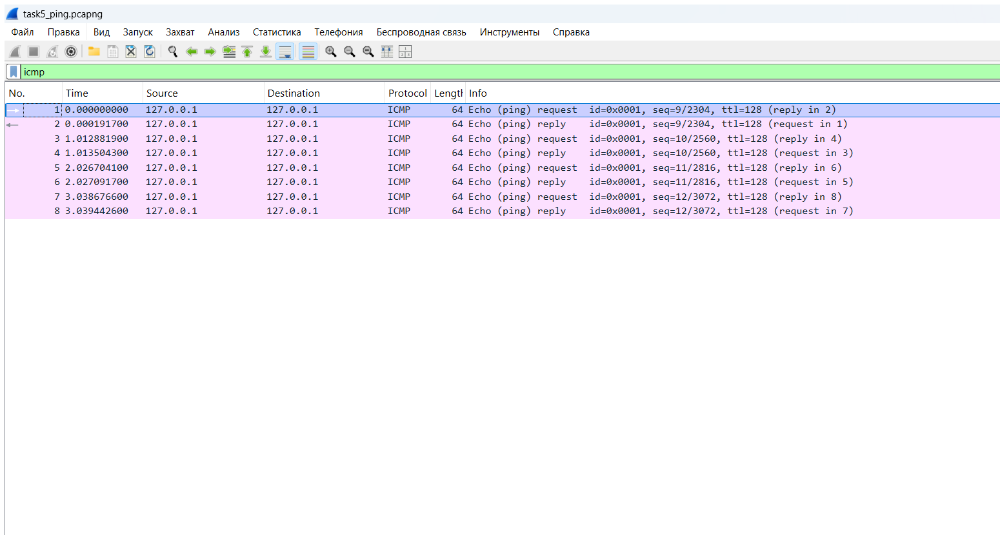

| № | Время, с | Источник | Получатель | Тип | Seq | Длина |
|---|---|---|---|---|---|---|
| 1 | 0,000000 | 127.0.0.1 | 127.0.0.1 | Echo request (8) | 9 | 64 |
| 2 | 0,000192 | 127.0.0.1 | 127.0.0.1 | Echo reply (0) | 9 | 64 |
| 3 | 1,012882 | 127.0.0.1 | 127.0.0.1 | Echo request (8) | 10 | 64 |
| 4 | 1,013504 | 127.0.0.1 | 127.0.0.1 | Echo reply (0) | 10 | 64 |
| 5 | 2,026704 | 127.0.0.1 | 127.0.0.1 | Echo request (8) | 11 | 64 |
| 6 | 2,027092 | 127.0.0.1 | 127.0.0.1 | Echo reply (0) | 11 | 64 |
| 7 | 3,038677 | 127.0.0.1 | 127.0.0.1 | Echo request (8) | 12 | 64 |
| 8 | 3,039443 | 127.0.0.1 | 127.0.0.1 | Echo reply (0) | 12 | 64 |

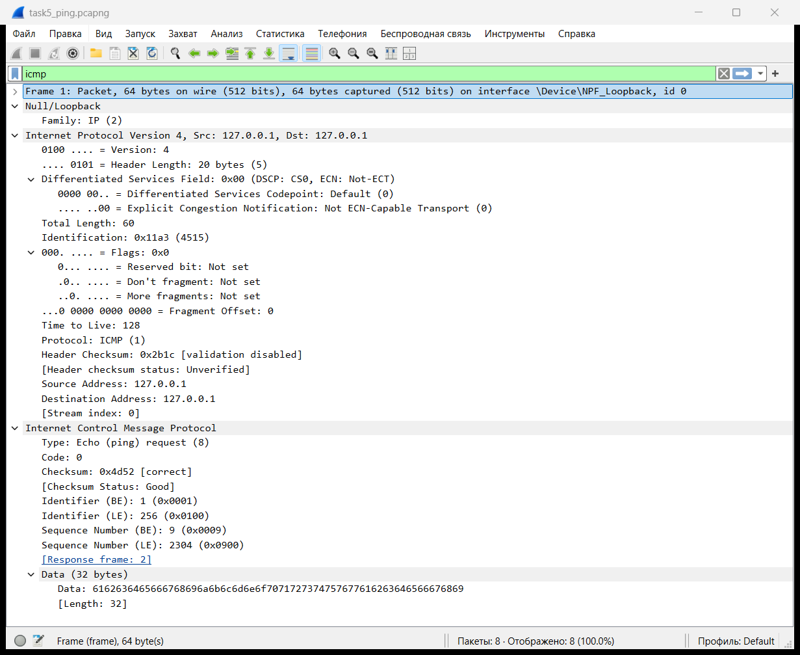

На loopback нет Ethernet-заголовка: инкапсуляция `NULL/Loopback (15)`, внутри поле `Family: IP (2)`, а уже за ним идут IPv4 и ICMP. Это нормально для петлевого интерфейса.

| Поле | Значение | Что означает |
|---|---|---|
| Type | 8 | Echo request (запрос ping) |
| Code | 0 | Для echo-запросов всегда 0 |
| Checksum | `0x4d52` | Контрольная сумма ICMP, Wireshark считает её правильной |
| Identifier | 1 | Идентификатор запроса, обычно связан с процессом ping |
| Sequence Number | 9 | Номер запроса; у ответа тот же |
| Data | 32 байта | Заполнитель `abcdefghijklmnopqrstuvwabcdefghi` |

В ответном пакете Type = 0 (Echo reply), Identifier и Sequence Number совпадают с запросом, а Wireshark дополнительно показывает поле `Response time` — время между запросом и ответом. По таблице видно, что оно меньше 1 мс (0,0002–0,0008 с).

Вывод команды ping: отправлено 4, получено 4, потерь 0 %, TTL 128, время меньше 1 мс.

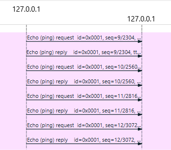

Использованные протоколы: **ICMP** (RFC 792), **IPv4** и loopback-инкапсуляция. ARP и Ethernet не участвуют, потому что адрес `127.0.0.1` не покидает машину. В реальной локальной сети перед первым ICMP-пакетом ещё выполнялся бы ARP-запрос, а кадры были бы Ethernet. Если повторить опыт для соседней станции, достаточно пинговать её IP на интерфейсе Wi-Fi с фильтром `icmp and host <IP>` — в захвате появятся Ethernet, ARP и ICMP.

## TCP-сервер и TCP-клиент

Захват вёлся на loopback с фильтром `tcp port 8080`. В клиенте были отправлены две строки: `hello server` и `second line`. Файл: `task6_tcp.pcapng`, 15 пакетов.

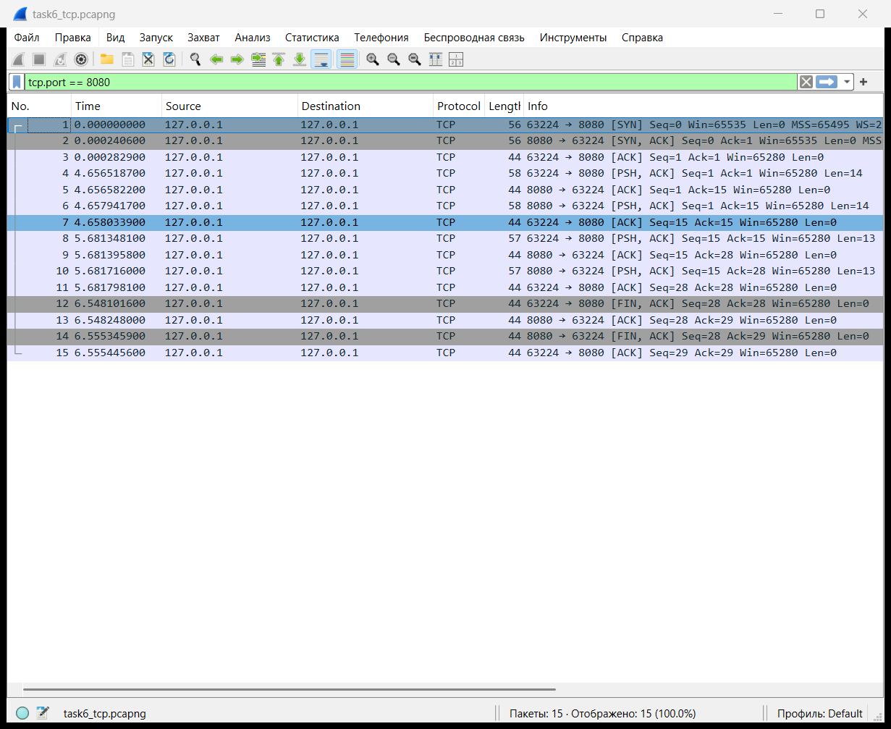

| № | Флаги | Len | Info |
|---|---|---|---|
| 1 | SYN | 0 | 63224 → 8080, Seq=0 |
| 2 | SYN, ACK | 0 | 8080 → 63224, Seq=0, Ack=1 |
| 3 | ACK | 0 | 63224 → 8080, Ack=1 |
| 4 | PSH, ACK | 14 | клиент отправил `hello server` |
| 5 | ACK | 0 | сервер подтвердил приём |
| 6 | PSH, ACK | 14 | сервер вернул ту же строку |
| 7 | ACK | 0 | клиент подтвердил |
| 8 | PSH, ACK | 13 | клиент отправил `second line` |
| 9 | ACK | 0 | сервер подтвердил |
| 10 | PSH, ACK | 13 | сервер вернул строку |
| 11 | ACK | 0 | клиент подтвердил |
| 12 | FIN, ACK | 0 | клиент начал закрытие |
| 13 | ACK | 0 | сервер подтвердил FIN |
| 14 | FIN, ACK | 0 | сервер закрыл свою сторону |
| 15 | ACK | 0 | клиент подтвердил |

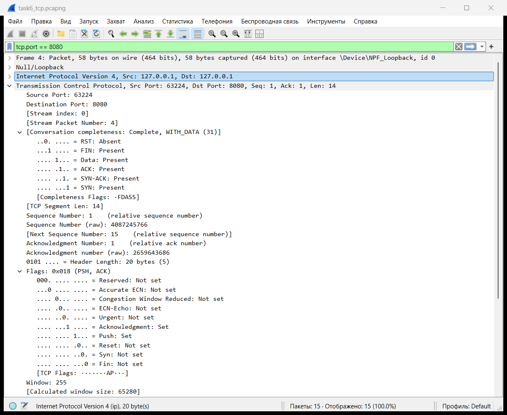

| Поле | Значение | Что означает |
|---|---|---|
| Source Port | 63224 | Порт клиента, выбран случайно |
| Destination Port | 8080 | Порт сервера |
| Sequence Number | 1 (raw 4087245766) | Номер первого байта данных в сегменте |
| Acknowledgment Number | 1 (raw 2659643686) | Номер байта, который ожидает принять отправитель |
| Header Length | 20 байт (5) | Длина TCP-заголовка без опций |
| Flags | `0x018` (PSH, ACK) | Есть данные (PSH) и подтверждение (ACK) |
| Window | 255 | Размер окна; с масштабом 256 даёт 65 280 байт |
| Checksum | `0x0ed7` | Контрольная сумма TCP |
| Urgent Pointer | 0 | Срочных данных нет |
| Options | нет | В сегменте с данными опций нет |

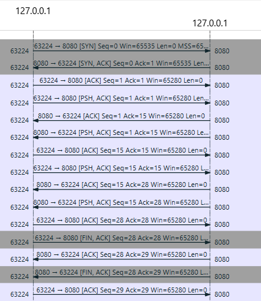

## UDP-сервер и UDP-клиент

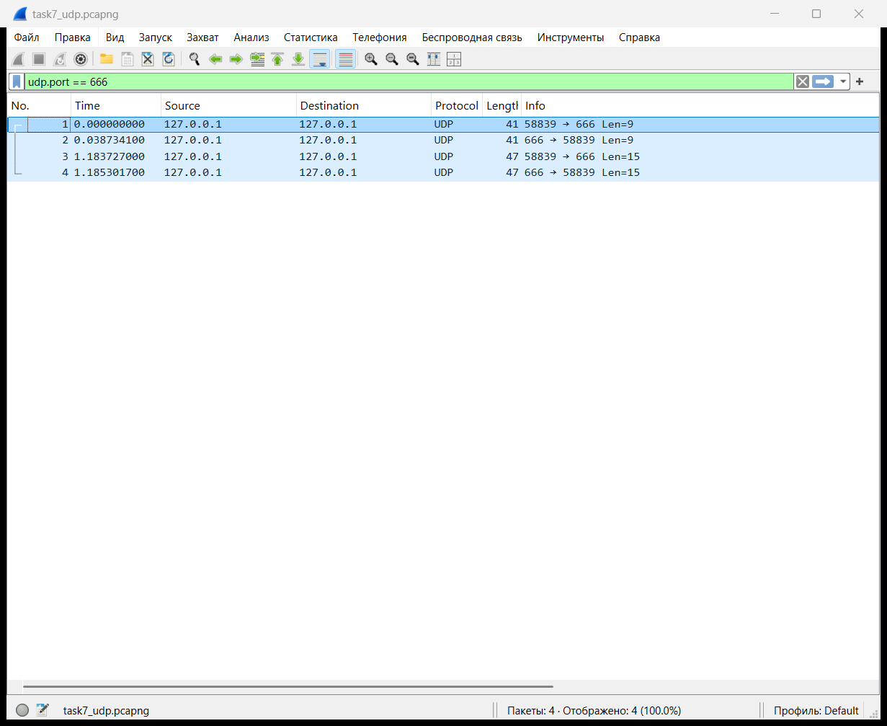

| № | Время, с | Источник | Получатель | Длина UDP | Payload |
|---|---|---|---|---|---|
| 1 | 0,000000 | 127.0.0.1:58839 | 127.0.0.1:666 | 17 | 9 байт, `hello udp` |
| 2 | 0,038734 | 127.0.0.1:666 | 127.0.0.1:58839 | 17 | 9 байт, эхо |
| 3 | 1,183727 | 127.0.0.1:58839 | 127.0.0.1:666 | 23 | 15 байт, `second datagram` |
| 4 | 1,185302 | 127.0.0.1:666 | 127.0.0.1:58839 | 23 | 15 байт, эхо |

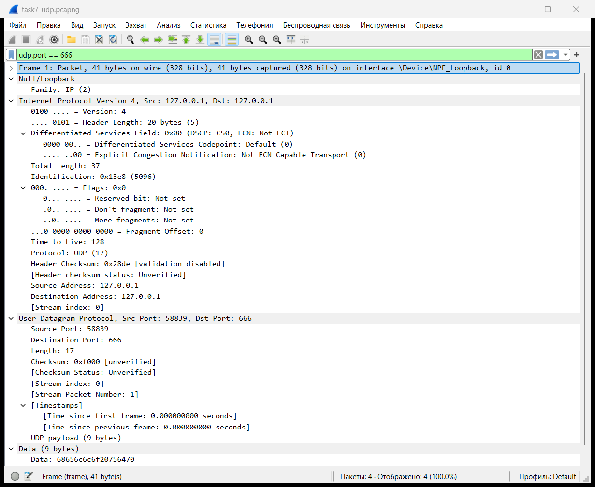

Поля UDP:

| Поле | Значение | Что означает |
|---|---|---|
| Source Port | 58839 | Порт клиента |
| Destination Port | 666 | Порт сервера |
| Length | 17 | 8 байт заголовка + 9 байт данных |
| Checksum | `0xf000` | Контрольная сумма; Wireshark показывает «unverified», проверка отключена |
| Data | 9 байт | `hello udp` |

## Протокол ARP

ARP (Address Resolution Protocol, RFC 826) нужен, чтобы по IP-адресу узнать MAC-адрес соседа в локальной сети. Перед отправкой IP-пакета хост смотрит в ARP-кэш. Если записи нет, он отправляет широковещательный запрос, а владелец адреса отвечает уже unicast-пакетом со своим MAC. После этого запись попадает в кэш.

В захвате появились запрос и ответ. Для анализа из полного захвата были выделены эти два пакета и сохранены в `task8_arp.pcapng`. Полный захват, в котором видно ещё и фоновые ARP-запросы, сохранён отдельно в `task8_arp_sweep.pcapng`.

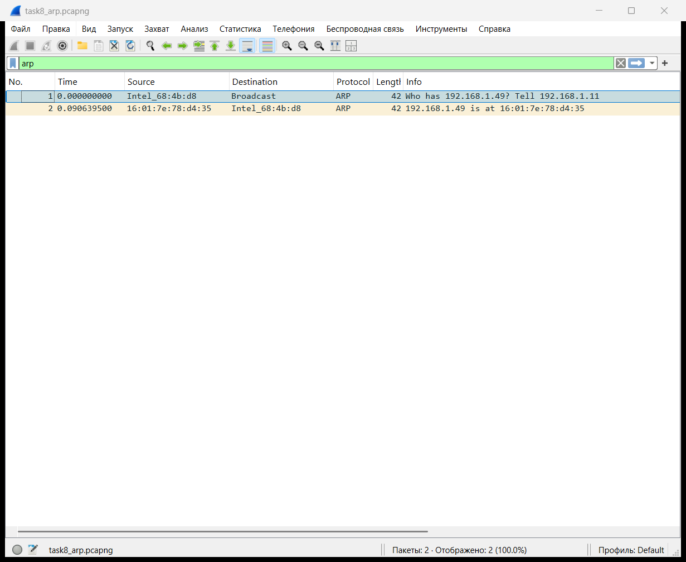

| № | Opcode | Sender MAC | Sender IP | Target MAC | Target IP | Ethernet Destination |
|---|---|---|---|---|---|---|
| 1 | request (1) | `04:ec:d8:68:4b:d8` | 192.168.1.11 | `00:00:00:00:00:00` | 192.168.1.49 | `ff:ff:ff:ff:ff:ff` |
| 2 | reply (2) | `16:01:7e:78:d4:35` | 192.168.1.49 | `04:ec:d8:68:4b:d8` | 192.168.1.11 | `04:ec:d8:68:4b:d8` |

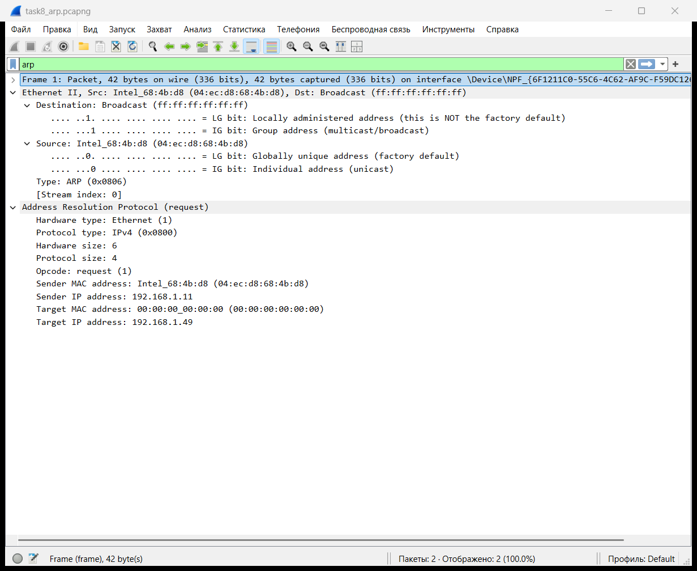

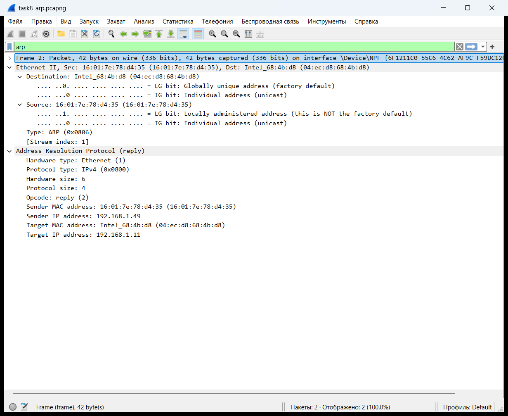

Поля ARP в запросе:

| Поле | Значение | Что означает |
|---|---|---|
| Hardware type | 1 | Ethernet |
| Protocol type | `0x0800` | IPv4 |
| Hardware size | 6 | Длина MAC-адреса 6 байт |
| Protocol size | 4 | Длина IPv4-адреса 4 байта |
| Opcode | 1 | Request |
| Sender MAC / IP | `04:ec:d8:68:4b:d8` / 192.168.1.11 | Кто спрашивает |
| Target MAC | `00:00:00:00:00:00` | Пока неизвестен, поэтому нули |
| Target IP | 192.168.1.49 | Чей MAC ищут |