# Лабораторная работа №3

**Студент:** Цибульскас Виктор Сергеевич

> В файле методички работа озаглавлена как «Лабораторная работа №4». В репозитории она идёт третьей — после работ по TCP- и UDP-сокетам, поэтому папка и ветка имеют номер `3`.

*1. Изучить краткие теоретические сведения по возможностям, приемам работы с программой Wireshark (файл netWS.pdf).*

**Изучил.** Wireshark — анализатор трафика (сниффер), который перехватывает PDU с сетевого адаптера, декодирует заголовки протоколов, позволяет фильтровать трафик, строить статистику и диаграммы взаимодействия. Захват можно вести на физическом или виртуальном интерфейсе; для анализа сохранённых файлов используется формат pcap/pcapng.

<br>

*2. Изучить: типы фильтрации трафика, правила построения фильтров, приемы статистической обработки сетевого трафика в Wireshark (материал приведен ниже).*

**Изучил.** В Wireshark есть два вида фильтрации:

- **Фильтры захвата (capture filters)** — применяются до записи пакетов, используют синтаксис BPF и уменьшают нагрузку на CPU/диск. Примеры: `host 100.70.46.48`, `tcp port 443`, `udp port 6666`, `icmp`, `arp or rarp`.
- **Фильтры отображения (display filters)** — применяются после захвата к уже сохранённым пакетам и не уменьшают нагрузку. Примеры: `ip`, `ip.addr == 100.70.46.134`, `tcp.port == 8080`, `udp.port == 6666`, `icmp`, `arp`, `tcp.flags.syn == 1 && tcp.flags.ack == 0`, `dns`.

Для статистики использовались `Statistics → Summary`, `Protocol Hierarchy`, `Conversations`, `IO Graph`, `Packet Lengths`, `Flow Graph` и `Expert Info`. Основные команды `tshark` и скрипты воспроизведения приведены в конце отчёта.

<br>

*3. Запустив Wireshark на захват, выполнить загрузку доступной в лабораторных условиях страницы (bstu.by, iit.bstu.by или др.). Остановить и сохранить захват. Для захваченных пакетов определить статистические данные: процентное соотношение трафика разных протоколов в сети; среднюю скорость кадров/сек; среднюю скорость байт/сек; минимальный, максимальный и средний размеры пакета; степень использования полосы пропускания канала (загрузку сети).*

**Ответ:**

Захват выполнялся на `en0` (Wi-Fi) в течение 30 секунд, в это время загружалась страница `https://bstu.by` (HTTP 200, 849 191 байт). В захват также попал фоновый трафик ОС и браузера, поэтому протокольная картина отражает реальную смесь трафика.

| Показатель | Значение |
|---|---:|
| Пакетов | 3110 |
| Длительность | 29,836712 с |
| Суммарный объём | 1 969 820 байт |
| Средняя скорость кадров | **104,23 кадра/с** |
| Средняя скорость байт | **66 020 байт/с** (528,16 кбит/с) |
| Размер кадра: min / max / avg | **42 / 1464 / 633,38 байт** |

Протокольный состав (по кадрам и байтам):

| Протокол | Кадров | Доля кадров | Байт (накопленно) | Доля байт |
|---|---:|---:|---:|---:|
| Ethernet | 3110 | 100,00 % | 1 969 820 | 100,00 % |
| IPv4 | 3108 | 99,94 % | 1 969 736 | 99,996 % |
| TCP | 3014 | 96,91 % | 1 932 167 | 98,09 % |
| UDP | 93 | 2,99 % | 37 499 | 1,90 % |
| ICMP | 1 | 0,03 % | 70 | 0,004 % |
| ARP | 2 | 0,06 % | 84 | 0,004 % |
| TLS (внутри TCP) | 1027 | 33,02 % | 496 880 | 25,22 % |
| QUIC (внутри UDP) | 68 | 2,19 % | 34 800 | 1,77 % |
| DNS | 4 | 0,13 % | 322 | 0,02 % |
| mDNS | 11 | 0,35 % | 1 599 | 0,08 % |

Основная доля байт — TCP/TLS (загрузка HTTPS-страницы). UDP представлен QUIC, DNS и mDNS; ICMP и ARP — служебные.

**Загрузка канала.** Для PHY-скорости Wi-Fi 300 Мбит/с (802.11n, 40 МГц, MCS 15):

```text
U = (1 969 820 × 8) / (29,836712 × 300 000 000) × 100 % = 0,176 %
```

Пиковая секунда (`3–4 с`): 884 кадра, 906 650 байт — **7,25 Мбит/с**, или **2,42 %** от 300 Мбит/с. Средняя загрузка мала, потому что загрузка страницы — короткий всплеск; для 100 Мбит/с средняя загрузка составила бы 0,528 %.

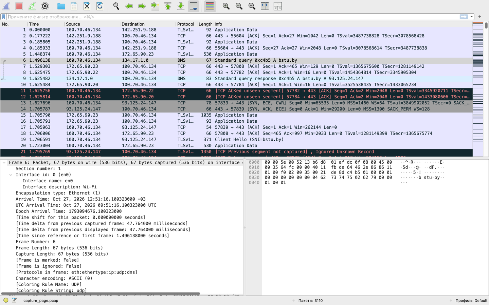

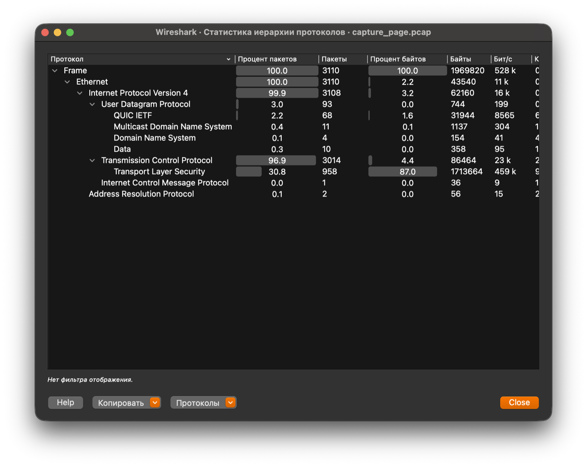

**Примечание.** В окне `Statistics → Protocol Hierarchy` Wireshark показывает **собственные** байты протокола (например, Ethernet — только заголовки 14 × 3110 = 43 540 байт), поэтому на скриншоте TLS = 87,0 % байт. В таблице выше использованы **накопленные** байты из `tshark -z io,phs` (TCP вместе с TLS), поэтому цифры отличаются, но доли кадров совпадают.

<br>

*4. Отфильтровать в захвате IP пакеты. Определить статистические данные: процентное соотношение трафика разных протоколов стека tcp/ip в сети; средний, минимальный, максимальный размеры пакета. На примере любого IP-пакета указать структуры протоколов Ethernet и IP. Отметить поля заголовков и описать их и интерпретировать их значения.*

**Ответ:**

После фильтра `ip` в захвате осталось **3108 пакетов** из 3110 (2 пакета — ARP).

| Протокол | Кадров | Доля кадров | Байт | Доля байт |
|---|---:|---:|---:|---:|
| TCP (`ip.proto = 6`) | 3014 | 96,98 % | 1 932 167 | 98,09 % |
| UDP (`ip.proto = 17`) | 93 | 2,99 % | 37 499 | 1,90 % |
| ICMP (`ip.proto = 1`) | 1 | 0,03 % | 70 | 0,004 % |
| **Всего IP** | **3108** | **100 %** | **1 969 736** | **100 %** |

Размеры пакетов:

| Что измеряется | Минимум | Максимум | Среднее |
|---|---:|---:|---:|
| Все кадры (`frame.len`) | 42 байт | 1464 байт | 633,38 байт |
| IP-кадры (`frame.len`) | 46 байт | 1464 байт | 633,76 байт |
| IP-пакеты (`ip.len`) | 32 байт | 1450 байт | 619,76 байт |

Минимальный IP-пакет — 32 байта (UDP с 4 байтами данных), максимальный — 1450 байт (TCP-сегмент с 1398 байтами данных). Разница между `frame.len` и `ip.len` — заголовок Ethernet (14 байт).

**Пример: кадр 6 (DNS-запрос `bstu.by`).**

| Уровень | Поле | Значение | Интерпретация |
|---|---|---|---|
| Ethernet | Destination MAC | `00:00:5e:00:52:13` | MAC шлюза `100.70.0.1` — следующий hop, так как DNS-сервер в другой подсети |
| Ethernet | Source MAC | `b6:d8:01:af:dc:0f` | MAC нашего Wi-Fi-адаптера (private Wi-Fi address) |
| Ethernet | Type | `0x0800` | В кадре — IPv4 |
| IPv4 | Version / IHL | 4 / 5 (20 байт) | IPv4, заголовок без options |
| IPv4 | Total Length | 53 | 20 байт IP + 33 байта UDP/DNS |
| IPv4 | Identification | `0x64fc` (25852) | Идентификатор для сборки фрагментов |
| IPv4 | Flags / Fragment Offset | `0x0` / 0 | Фрагментация не требуется |
| IPv4 | TTL | 64 | Пакет не проходил через маршрутизаторы |
| IPv4 | Protocol | 17 (UDP) | Внутри — UDP/DNS |
| IPv4 | Header Checksum | `0xfbde` | Wireshark показывает `validation disabled` из-за checksum offload |
| IPv4 | Source / Destination | `100.70.46.134` / `134.17.1.0` | Наш IP / DNS-сервер |

Кадр 6 иллюстрирует инкапсуляцию **Ethernet II → IPv4 → UDP → DNS**: MAC-адреса отвечают за доставку до шлюза, IP-адреса — за маршрутизацию до DNS-сервера.

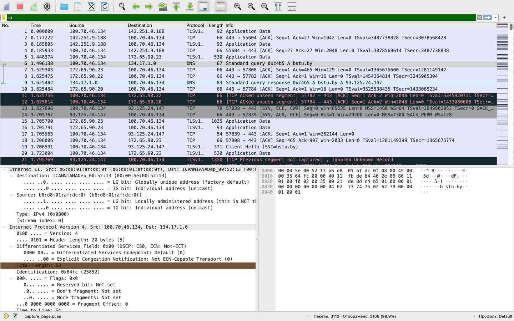

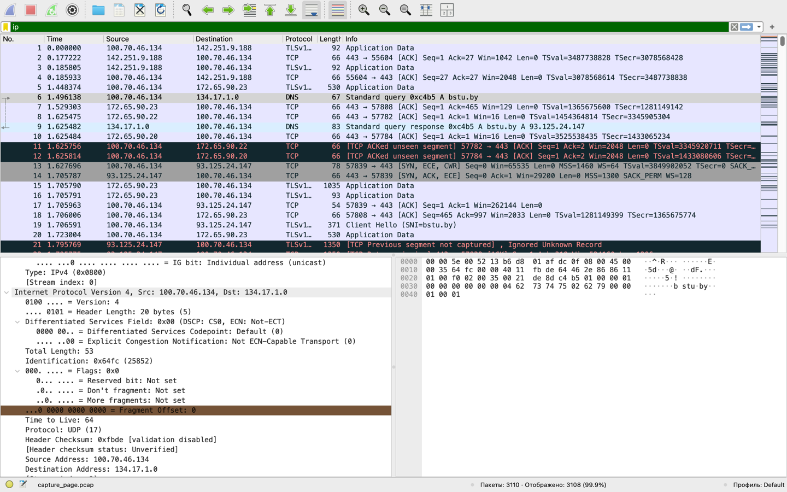

<br>

*5. Запустив Wireshark на захват, выполнить команду ping для IP адреса соседней рабочей станции в лаборатории (предварительно определив ее адрес с помощью ipconfig). Сохранить результат. Сформировав нужный фильтр, отфильтровать пакеты, относящиеся к выполнению команды ping. На базе полученных пакетов и значений их полей интерпретировать результат работы утилиты ping. Описать все протоколы, используемые утилитой. Составить диаграмму взаимодействия машин при работе утилиты ping.*

**Ответ:**

Соседний узел — `100.70.46.48` (MAC `4a:23:64:7c:fa:4b`). Выполнено `ping -c 4 100.70.46.48`:

```text
PING 100.70.46.48 (100.70.46.48): 56 data bytes
64 bytes from 100.70.46.48: icmp_seq=0 ttl=64 time=12.068 ms
64 bytes from 100.70.46.48: icmp_seq=1 ttl=64 time=14.116 ms
64 bytes from 100.70.46.48: icmp_seq=2 ttl=64 time=10.700 ms
64 bytes from 100.70.46.48: icmp_seq=3 ttl=64 time=11.734 ms

4 packets transmitted, 4 packets received, 0% packet loss
round-trip min/avg/max/stddev = 10.700/12.155/14.116/1.240 ms
```

В захвате 8 пакетов: 4 Echo Request (type 8) и 4 Echo Reply (type 0), идентификатор `34824`, последовательности 0–3, TTL 64, длина кадра 98 байт (14 Ethernet + 20 IPv4 + 8 ICMP + 56 данных). Потери 0 %, RTT ≈ 10,7–14,1 мс, TTL 64 указывает на локальный сегмент. ICMP checksum — `correct`.

Используемые протоколы: **ARP** (разрешение IPv4 → MAC), **ICMP** (Echo Request/Reply, RFC 792), **IPv4** (адресация и TTL, RFC 791), **Ethernet II** (доставка кадра, IEEE 802.3). DNS, TCP и UDP не используются.

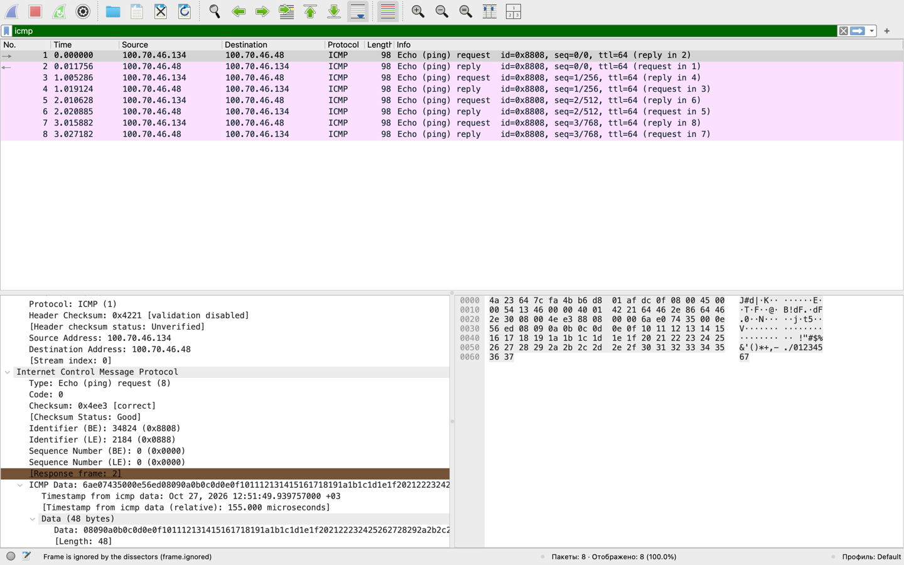

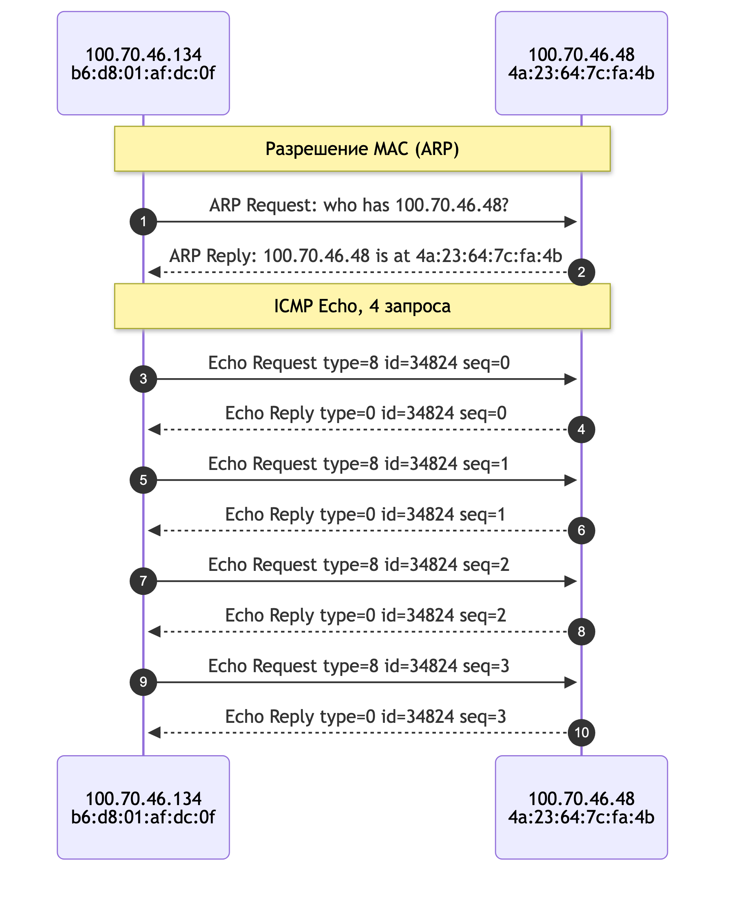

<br>

*6. Запустив Wireshark на захват, выполнить разработанный в предыдущей лабораторной работе TCP-сервер и TCP-клиент. Сохранить результат. Сформировав нужный фильтр, отфильтровать пакеты данного сеанса. На примере любого TCP-сегмента указать структуру протокола TCP. Отметить поля заголовка, описать их и интерпретировать их значения. Составить диаграмму взаимодействия TCP-сервера и TCP-клиента.*

**Ответ:**

Использованы `TcpServer` и `TcpClient` из лабораторной работы №1: сервер слушает порт 8080, клиент подключается к `127.0.0.1:8080`, отправляет две строки и получает эхо. Захват — `lo0`, фильтр `tcp port 8080`, 18 пакетов. GUI-клиент автоматизирован вспомогательным драйвером, журнал сеанса вёлся отдельно.

Установка соединения: SYN (кадр 1) → SYN/ACK (кадр 2) → ACK (кадр 3). Затем сервер отправляет `Hello, Student!` (16 байт), клиент — две строки (29 и 30 байт), сервер возвращает эхо. Завершение — FIN/ACK, ACK, FIN/ACK, ACK (кадры 15–18).

**Заголовок TCP (кадр 7, `Hello from TcpClient (lab 1)`):**

| Поле | Значение | Интерпретация |
|---|---|---|
| Source Port | 57856 | Эфемерный порт клиента |
| Destination Port | 8080 | Порт TCP-сервера |
| Sequence Number | 1 (relative), raw `3857653014` | Первый байт данных; SYN занял номер 0 |
| Acknowledgment Number | 17 (relative), raw `3710837064` | Подтверждены 16 байт приветствия + SYN |
| Data Offset | 8 слов = 32 байта | 12 байт options |
| Flags | `PSH, ACK` (`0x018`) | PSH — отдать данные приложению, ACK — подтверждение |
| Window | 6380 × 64 = 408 320 байт | Окно приёма с учётом window scale |
| Checksum | `0xfe45` | Контрольная сумма TCP (`unverified` из-за offload) |
| Urgent Pointer | 0 | Срочных данных нет |
| Options | NOP, NOP, Timestamps (12 байт) | Выравнивание и метки времени |
| Payload | 29 байт | `Hello from TcpClient (lab 1)` |

В SYN-сегменте согласованы MSS 16 344 (loopback MTU 16 384), window scale 6, SACK permitted и timestamps. Повторных передач и потерь в TCP-захвате нет.

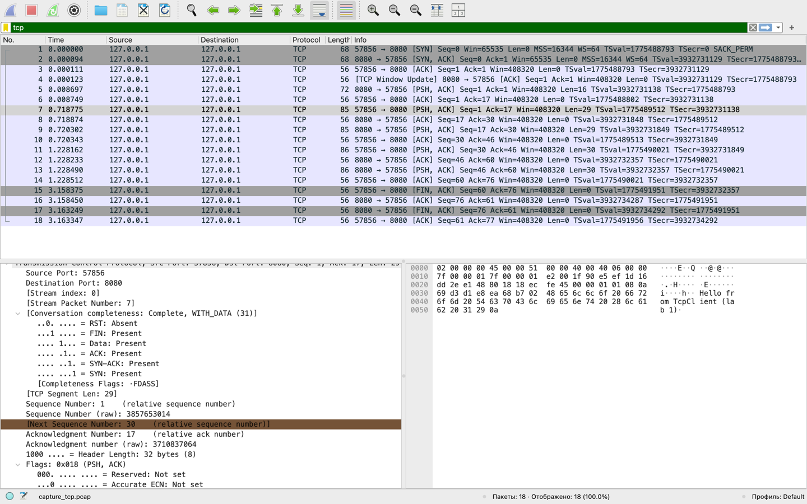

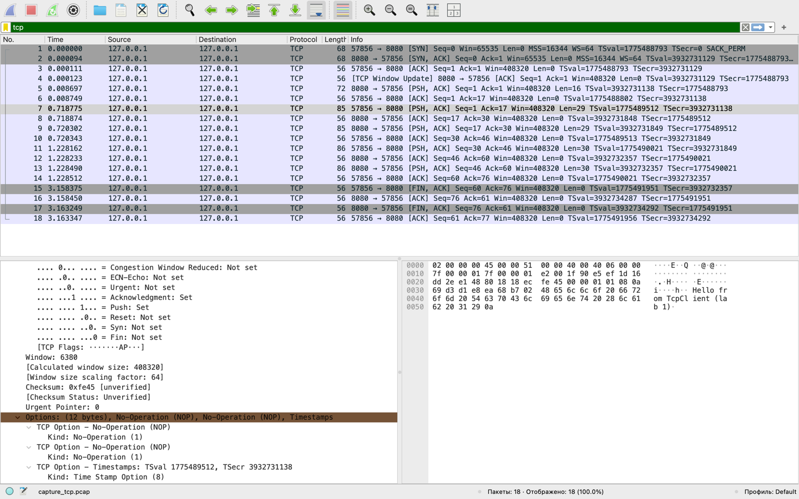

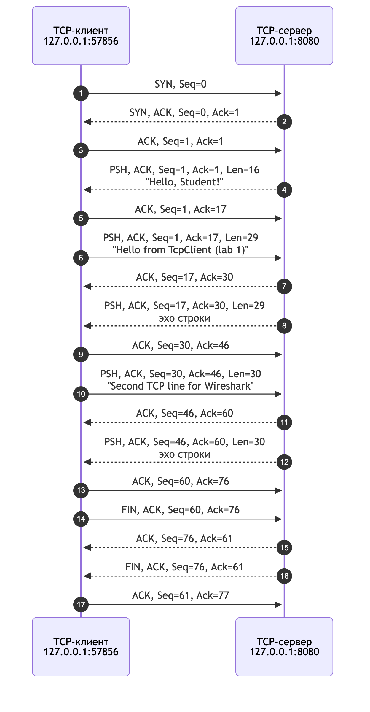

<br>

*7. Запустив Wireshark на захват, выполнить разработанный в предыдущей лабораторной работе UDP-сервер и UDP-клиент. Сохранить результат. Сформировав нужный фильтр, отфильтровать пакеты данного сеанса. На примере любого UDP-сегмента указать структуру протокола UDP. Отметить поля заголовка, описать их и интерпретировать их значения.*

**Ответ:**

Использованы `UdpServer` и `UdpClient` из лабораторной работы №2. Сервер слушает порт 6666; клиент в консольном режиме отправляет строку `0123456789ABCDEFGHIJ`, сервер разбивает поток на блоки по 10 ASCII-символов и возвращает контрольные суммы **525** и **695**, затем клиент отправляет `disconnect 127.0.0.1 6666` и получает подтверждение. Захват — `lo0`, фильтр `udp port 6666`, 5 пакетов.

| № | Направление | Порты | UDP Length | Checksum | Данные |
|---:|---|---|---:|---|---:|
| 1 | клиент → сервер | 59441 → 6666 | 28 | `0xfe2f` | 20 байт |
| 2 | сервер → клиент | 6666 → 59441 | 148 | `0xfea7` | 140 байт |
| 3 | сервер → клиент | 6666 → 59441 | 148 | `0xfea7` | 140 байт |
| 4 | клиент → сервер | 59441 → 6666 | 33 | `0xfe34` | 25 байт |
| 5 | сервер → клиент | 6666 → 59441 | 84 | `0xfe67` | 76 байт |

**Заголовок UDP (кадр 1):**

| Поле | Значение | Интерпретация |
|---|---|---|
| Source Port | 59441 | Эфемерный порт клиента |
| Destination Port | 6666 | Порт UDP-сервера |
| Length | 28 | 8 байт заголовка + 20 байт данных |
| Checksum | `0xfe2f` | Контрольная сумма UDP (в IPv4 необязательна, но стек её вычисляет) |
| Data | 20 байт | `0123456789ABCDEFGHIJ` |

UDP не устанавливает соединение: в захвате нет SYN/ACK и подтверждений на транспортном уровне. Поле Length задаёт границы датаграммы, Checksum — целостность данных и псевдозаголовка IP. Контрольные суммы сервера подтверждают правильную разбивку потока на блоки по 10 символов.

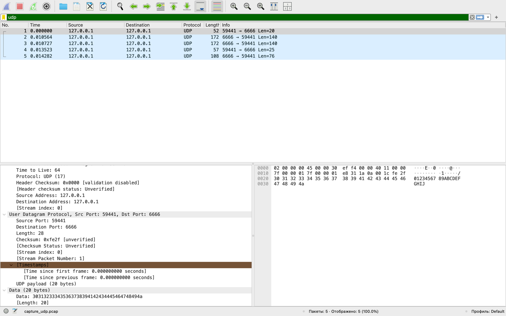

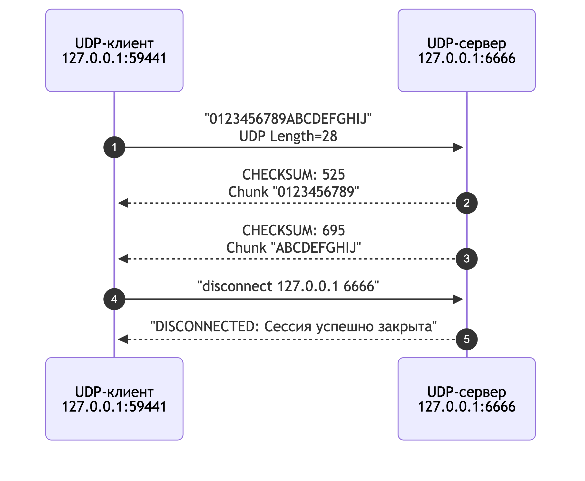

<br>

*8. Выполнить анализ ARP-протокола по примеру из методических указаний.*

**Ответ:**

ARP-трафик захватывался на `en0` фильтром `arp`. Получены два характерных случая.

**Широковещательный запрос и proxy-ответ.** Для адреса `100.70.46.47`, которого не было в ARP-кэше, отправлен запрос:

- Ethernet Destination — `ff:ff:ff:ff:ff:ff` (broadcast);
- Opcode — 1 (request);
- Sender MAC/IP — `b6:d8:01:af:dc:0f` / `100.70.46.134`;
- Target MAC — `00:00:00:00:00:00`;
- Target IP — `100.70.46.47`.

Ответ пришёл от шлюза `100.70.0.1` с MAC `00:00:5e:00:52:13` (opcode 2, reply), при этом Sender IP = `100.70.46.47`. Это **proxy ARP**: шлюз отвечает от имени адреса, а в кэше для `.47` сохраняется MAC шлюза.

**Прямой ARP-обмен с соседом.** Для `100.70.46.48` macOS отправила unicast ARP-запрос (Target MAC уже заполнен `4a:23:64:7c:fa:4b`) — это проверка/обновление существующей записи. Узел `.48` ответил напрямую своим MAC. В `arp -a` появилась запись:

```text
? (100.70.46.48) at 4a:23:64:7c:fa:4b on en0 ifscope [ethernet]
? (100.70.46.47) at 0:0:5e:0:52:13 on en0 ifscope [ethernet]
```

Записи `.47`, `.10`, `.51` указывают на MAC шлюза — результат proxy ARP. RARP в захвате не наблюдался: он решает обратную задачу (MAC → IPv4) и в современных сетях почти не используется.

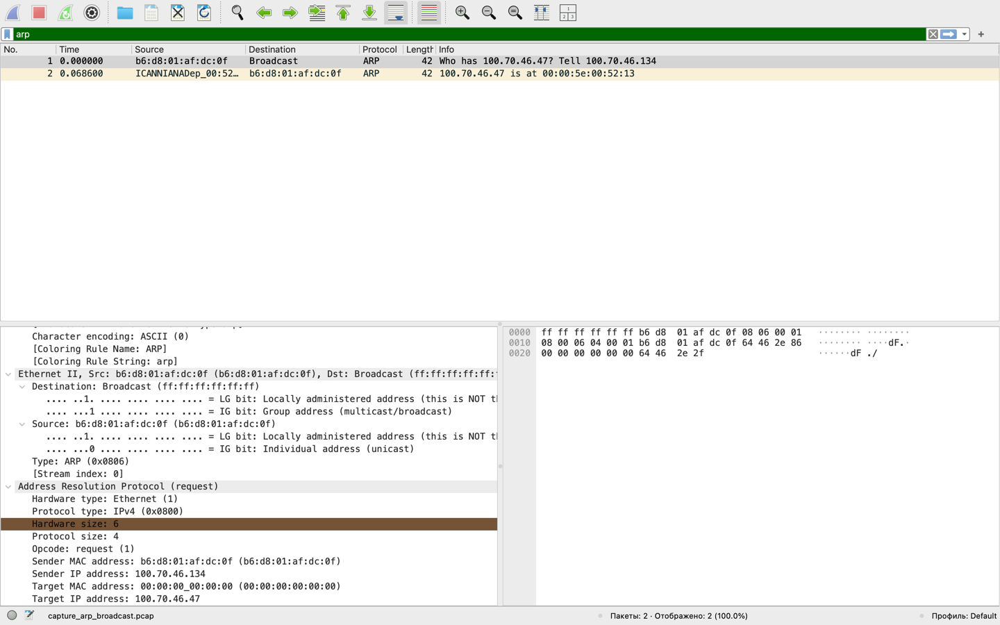

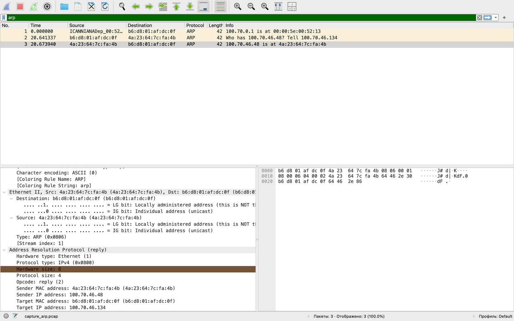

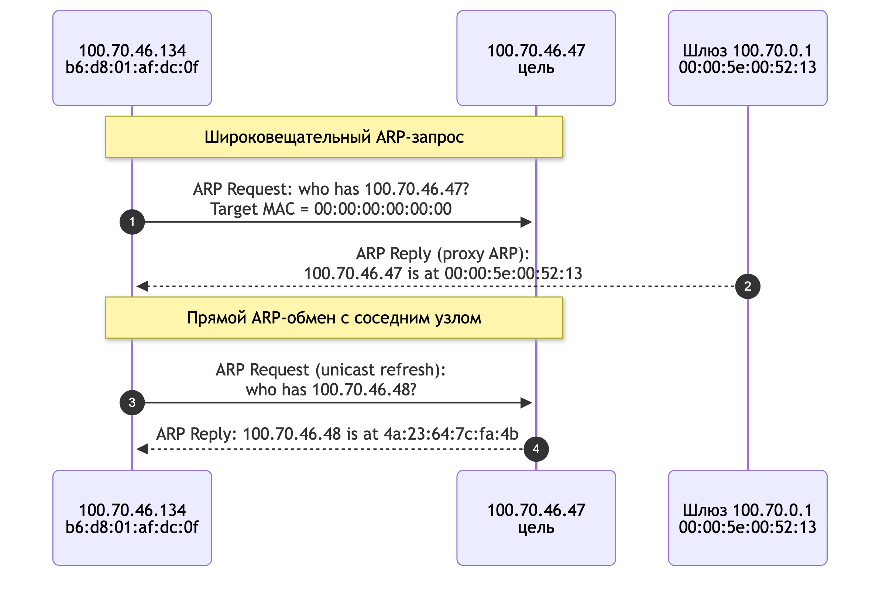

<br>

## Ответы на контрольные вопросы

**1. Основные цели мониторинга сетевого трафика.** Диагностика неисправностей, анализ производительности и загрузки канала, поиск узких мест, обнаружение атак и аномалий, контроль политик, учёт трафика, отладка приложений и протоколов, обучение.

**2. Чем отличается мониторинг трафика от фильтрации?** Мониторинг — наблюдение, захват и анализ трафика в целом. Фильтрация — выделение подмножества по критериям (протокол, адрес, порт, значение поля); она является частью мониторинга и уменьшает объём данных.

**3. Назначение класса программ-снифферов.** Перехват и анализ сетевых пакетов (PDU), проходящих через адаптер, для диагностики, разработки, обучения и анализа безопасности.

**4. Основные функции снифферов.** Захват, декодирование заголовков и полезной нагрузки, фильтрация, поиск, статистика, графы взаимодействия, сохранение/экспорт, экспертный анализ ошибок и повторных передач.

**5. Зачем нужны фильтры отображения и фильтры захвата? В чём отличие?** Capture filters (BPF) применяются до записи: драйвер передаёт снифферу только подходящие пакеты, снижая нагрузку и размер файла, но отфильтрованное уже не вернуть. Display filters применяются после захвата, не уменьшают нагрузку, зато позволяют многократно менять критерии и видеть исходный набор.

**6. Базовые функции статистической обработки Wireshark.** `Summary`, `Protocol Hierarchy`, `Conversations`/`Endpoints`, `IO Graph`/`IO Statistics`, `Packet Lengths`, `Flow Graph`, `Expert Info`, `Service Response Time`, `Follow TCP/UDP Stream`.

**7. Задачи протокола ARP.** Сопоставление IPv4- и MAC-адресов в локальном сегменте, ведение ARP-кэша, обнаружение конфликтов адресов. RARP решает обратную задачу (MAC → IPv4), но почти не используется.

<br>

## Файлы работы

В удалённую ветку включены только отчёт и скриншоты. Исходные pcap-файлы, скрипты захвата и выписки `tshark` в неё не коммитились.

| Файл | Описание |
|---|---|
| [`README.md`](README.md) | Отчёт по лабораторной работе |
| [`screenshots/`](screenshots/) | Скриншоты Wireshark и диаграммы взаимодействия |

## Использованные источники

1. Методические указания к лабораторной работе «Анализ сетевого трафика и протоколов на базе Wireshark».
2. `netWS.pdf` — краткие теоретические сведения по Wireshark.
3. RFC 791 (IP), RFC 792 (ICMP), RFC 826 (ARP), RFC 903 (RARP), RFC 9293 (TCP), RFC 768 (UDP).
4. Wireshark User's Guide. — URL: https://www.wireshark.org/docs/
