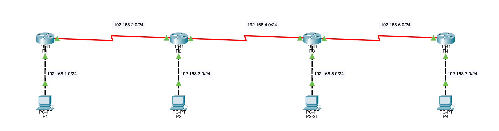

Министерство образования Республики Беларусь
Учреждение образования
«Брестский Государственный технический университет»
Кафедра ИИТ

**Лабораторная работа №5**
По дисциплине «Аппаратное и программное обеспечение сетей»
Тема: «Настройка статической маршрутизации на устройствах Cisco.»

**Выполнил:**
Студент 3 курса
Группы ИИ-28
Цибульскас В.С.

**Проверила:**
Прохорова С.С.

Брест 2026

---

**Цель работы:** Изучить принципы настройки статической маршрутизации на маршрутизаторах Cisco и обеспечить связность между конечными узлами сети.

**Ход работы:**

**Вариант 2**

**НАЧАЛЬНАЯ ТОПОЛОГИЯ:**

Схема варианта 2 — цепочка из четырёх маршрутизаторов R1–R2–R3–R4, к каждому из которых подключена одна рабочая станция (P1, P2, P2-2T, P4).

Маршрутизаторы соединены последовательными (serial) каналами, рабочие станции — кабелем crossover с интерфейсом Gi0/0 своего маршрутизатора. В качестве маршрутизаторов использована модель Cisco 1941 с установленным модулем HWIC-2T (два последовательных порта S0/0/0 и S0/0/1); в Packet Tracer 9.0.1 модель 1841 из примера не принимает модули WIC, поэтому взята модель того же семейства ISR с равнозначными интерфейсами.



*Рисунок 1 — Топология сети варианта 2 с адресами сетей.*

**ТАБЛИЦА ЗАПОЛНЕНИЯ**

| Устройство | Интерфейс | IP-адрес | Маска подсети | Шлюз | Подключение |
| :--- | :--- | :--- | :--- | :--- | :--- |
| P1 | FastEthernet0 | 192.168.1.10 | 255.255.255.0 | 192.168.1.1 | R1 (Gi0/0) |
| P2 | FastEthernet0 | 192.168.3.10 | 255.255.255.0 | 192.168.3.1 | R2 (Gi0/0) |
| P2-2T | FastEthernet0 | 192.168.5.10 | 255.255.255.0 | 192.168.5.1 | R3 (Gi0/0) |
| P4 | FastEthernet0 | 192.168.7.10 | 255.255.255.0 | 192.168.7.1 | R4 (Gi0/0) |
| R1 | Gi0/0 | 192.168.1.1 | 255.255.255.0 | N/A | P1 |
| R1 | Se0/0/0 | 192.168.2.1 | 255.255.255.0 | N/A | R2 (Se0/0/0) |
| R2 | Gi0/0 | 192.168.3.1 | 255.255.255.0 | N/A | P2 |
| R2 | Se0/0/0 | 192.168.2.2 | 255.255.255.0 | N/A | R1 (Se0/0/0) |
| R2 | Se0/0/1 | 192.168.4.1 | 255.255.255.0 | N/A | R3 (Se0/0/0) |
| R3 | Gi0/0 | 192.168.5.1 | 255.255.255.0 | N/A | P2-2T |
| R3 | Se0/0/0 | 192.168.4.2 | 255.255.255.0 | N/A | R2 (Se0/0/1) |
| R3 | Se0/0/1 | 192.168.6.1 | 255.255.255.0 | N/A | R4 (Se0/0/0) |
| R4 | Gi0/0 | 192.168.7.1 | 255.255.255.0 | N/A | P4 |
| R4 | Se0/0/0 | 192.168.6.2 | 255.255.255.0 | N/A | R3 (Se0/0/1) |

Конфигурация конечных устройств (PC) проводилась вручную через окно IP Config.
Маршрутизаторы настраивались через CLI.

**Базовая настройка (пример для R1)**

```text
enable
configure terminal

hostname R1

interface GigabitEthernet0/0
ip address 192.168.1.1 255.255.255.0
no shutdown
exit

interface Serial0/0/0
ip address 192.168.2.1 255.255.255.0
clock rate 64000
no shutdown
exit

end
write
```

Аналогично настроены остальные маршрутизаторы: R2 — Gi0/0 192.168.3.1/24, Se0/0/0 192.168.2.2/24, Se0/0/1 192.168.4.1/24 (DCE, `clock rate 64000`); R3 — Gi0/0 192.168.5.1/24, Se0/0/0 192.168.4.2/24, Se0/0/1 192.168.6.1/24 (DCE, `clock rate 64000`); R4 — Gi0/0 192.168.7.1/24, Se0/0/0 192.168.6.2/24.

**Настройка статической маршрутизации**

Каждый маршрутизатор получает статические маршруты ко всем сетям, которые не подключены к нему напрямую, через адрес следующего устройства (соседнего маршрутизатора в цепочке).

R1 — маршруты ко всем сетям за R2 через 192.168.2.2:

```text
R1(config)#ip route 192.168.3.0 255.255.255.0 192.168.2.2
R1(config)#ip route 192.168.4.0 255.255.255.0 192.168.2.2
R1(config)#ip route 192.168.5.0 255.255.255.0 192.168.2.2
R1(config)#ip route 192.168.6.0 255.255.255.0 192.168.2.2
R1(config)#ip route 192.168.7.0 255.255.255.0 192.168.2.2
```

R2 — к сети R1 через 192.168.2.1, к сетям за R3 через 192.168.4.2:

```text
R2(config)#ip route 192.168.1.0 255.255.255.0 192.168.2.1
R2(config)#ip route 192.168.5.0 255.255.255.0 192.168.4.2
R2(config)#ip route 192.168.6.0 255.255.255.0 192.168.4.2
R2(config)#ip route 192.168.7.0 255.255.255.0 192.168.4.2
```

R3 — к сетям за R2 через 192.168.4.1, к сети R4 через 192.168.6.2:

```text
R3(config)#ip route 192.168.1.0 255.255.255.0 192.168.4.1
R3(config)#ip route 192.168.2.0 255.255.255.0 192.168.4.1
R3(config)#ip route 192.168.3.0 255.255.255.0 192.168.4.1
R3(config)#ip route 192.168.7.0 255.255.255.0 192.168.6.2
```

R4 — ко всем сетям за R3 через 192.168.6.1:

```text
R4(config)#ip route 192.168.1.0 255.255.255.0 192.168.6.1
R4(config)#ip route 192.168.2.0 255.255.255.0 192.168.6.1
R4(config)#ip route 192.168.3.0 255.255.255.0 192.168.6.1
R4(config)#ip route 192.168.4.0 255.255.255.0 192.168.6.1
R4(config)#ip route 192.168.5.0 255.255.255.0 192.168.6.1
```

Параметры команды `ip route`: сеть назначения — маска сети назначения — адрес следующего устройства (ближайший интерфейс соседнего маршрутизатора).

Настройки сохранены на всех устройствах командой `write memory` (`copy running-config startup-config`).

**ПРОВЕРКА КОНФИГУРАЦИИ:**

Проверка активности интерфейсов и адресов — `show ip interface brief`:

```text
R1#show ip interface brief
Interface              IP-Address      OK? Method Status                Protocol
GigabitEthernet0/0     192.168.1.1     YES manual up                    up
GigabitEthernet0/1     unassigned      YES NVRAM  administratively down down
Serial0/0/0            192.168.2.1     YES manual up                    up
Serial0/0/1            unassigned      YES unset  down                  down
Vlan1                  unassigned      YES NVRAM  administratively down down
```

```text
R2#show ip interface brief
Interface              IP-Address      OK? Method Status                Protocol
GigabitEthernet0/0     192.168.3.1     YES manual up                    up
GigabitEthernet0/1     unassigned      YES NVRAM  administratively down down
Serial0/0/0            192.168.2.2     YES manual up                    up
Serial0/0/1            192.168.4.1     YES manual up                    up
Vlan1                  unassigned      YES NVRAM  administratively down down
```

```text
R3#show ip interface brief
Interface              IP-Address      OK? Method Status                Protocol
GigabitEthernet0/0     192.168.5.1     YES manual up                    up
GigabitEthernet0/1     unassigned      YES NVRAM  administratively down down
Serial0/0/0            192.168.4.2     YES manual up                    up
Serial0/0/1            192.168.6.1     YES manual up                    up
Vlan1                  unassigned      YES NVRAM  administratively down down
```

```text
R4#show ip interface brief
Interface              IP-Address      OK? Method Status                Protocol
GigabitEthernet0/0     192.168.7.1     YES manual up                    up
GigabitEthernet0/1     unassigned      YES NVRAM  administratively down down
Serial0/0/0            192.168.6.2     YES manual up                    up
Serial0/0/1            unassigned      YES unset  down                  down
Vlan1                  unassigned      YES NVRAM  administratively down down
```

Таблицы маршрутизации — `show ip route`:

```text
R1#show ip route
Gateway of last resort is not set

     192.168.1.0/24 is variably subnetted, 2 subnets, 2 masks
C       192.168.1.0/24 is directly connected, GigabitEthernet0/0
L       192.168.1.1/32 is directly connected, GigabitEthernet0/0
     192.168.2.0/24 is variably subnetted, 2 subnets, 2 masks
C       192.168.2.0/24 is directly connected, Serial0/0/0
L       192.168.2.1/32 is directly connected, Serial0/0/0
S    192.168.3.0/24 [1/0] via 192.168.2.2
S    192.168.4.0/24 [1/0] via 192.168.2.2
S    192.168.5.0/24 [1/0] via 192.168.2.2
S    192.168.6.0/24 [1/0] via 192.168.2.2
S    192.168.7.0/24 [1/0] via 192.168.2.2
```

```text
R2#show ip route
Gateway of last resort is not set

S    192.168.1.0/24 [1/0] via 192.168.2.1
     192.168.2.0/24 is variably subnetted, 2 subnets, 2 masks
C       192.168.2.0/24 is directly connected, Serial0/0/0
L       192.168.2.2/32 is directly connected, Serial0/0/0
     192.168.3.0/24 is variably subnetted, 2 subnets, 2 masks
C       192.168.3.0/24 is directly connected, GigabitEthernet0/0
L       192.168.3.1/32 is directly connected, GigabitEthernet0/0
     192.168.4.0/24 is variably subnetted, 2 subnets, 2 masks
C       192.168.4.0/24 is directly connected, Serial0/0/1
L       192.168.4.1/32 is directly connected, Serial0/0/1
S    192.168.5.0/24 [1/0] via 192.168.4.2
S    192.168.6.0/24 [1/0] via 192.168.4.2
S    192.168.7.0/24 [1/0] via 192.168.4.2
```

```text
R3#show ip route
Gateway of last resort is not set

S    192.168.1.0/24 [1/0] via 192.168.4.1
S    192.168.2.0/24 [1/0] via 192.168.4.1
S    192.168.3.0/24 [1/0] via 192.168.4.1
     192.168.4.0/24 is variably subnetted, 2 subnets, 2 masks
C       192.168.4.0/24 is directly connected, Serial0/0/0
L       192.168.4.2/32 is directly connected, Serial0/0/0
     192.168.5.0/24 is variably subnetted, 2 subnets, 2 masks
C       192.168.5.0/24 is directly connected, GigabitEthernet0/0
L       192.168.5.1/32 is directly connected, GigabitEthernet0/0
     192.168.6.0/24 is variably subnetted, 2 subnets, 2 masks
C       192.168.6.0/24 is directly connected, Serial0/0/1
L       192.168.6.1/32 is directly connected, Serial0/0/1
S    192.168.7.0/24 [1/0] via 192.168.6.2
```

```text
R4#show ip route
Gateway of last resort is not set

S    192.168.1.0/24 [1/0] via 192.168.6.1
S    192.168.2.0/24 [1/0] via 192.168.6.1
S    192.168.3.0/24 [1/0] via 192.168.6.1
S    192.168.4.0/24 [1/0] via 192.168.6.1
S    192.168.5.0/24 [1/0] via 192.168.6.1
     192.168.6.0/24 is variably subnetted, 2 subnets, 2 masks
C       192.168.6.0/24 is directly connected, Serial0/0/0
L       192.168.6.2/32 is directly connected, Serial0/0/0
     192.168.7.0/24 is variably subnetted, 2 subnets, 2 masks
C       192.168.7.0/24 is directly connected, GigabitEthernet0/0
L       192.168.7.1/32 is directly connected, GigabitEthernet0/0
```

Обозначение `C` — непосредственно подключённая сеть, `L` — адрес самого интерфейса, `S` — статический маршрут. Записи `S` во всех четырёх таблицах подтверждают, что маршрутизация настроена.

**ПИНГ:**

P1 – P4 (через три транзитных маршрутизатора):

```text
C:\>ping 192.168.7.10
Pinging 192.168.7.10 with 32 bytes of data:

Reply from 192.168.7.10: bytes=32 time=21ms TTL=124
Reply from 192.168.7.10: bytes=32 time=30ms TTL=124
Reply from 192.168.7.10: bytes=32 time=43ms TTL=124
Reply from 192.168.7.10: bytes=32 time=41ms TTL=124

Ping statistics for 192.168.7.10:
    Packets: Sent = 4, Received = 4, Lost = 0 (0% loss),
Approximate round trip times in milli-seconds:
    Minimum = 21ms, Maximum = 43ms, Average = 33ms
```

P4 – P1 (обратное направление):

```text
C:\>ping 192.168.1.10
Pinging 192.168.1.10 with 32 bytes of data:

Reply from 192.168.1.10: bytes=32 time=45ms TTL=124
Reply from 192.168.1.10: bytes=32 time=43ms TTL=124
Reply from 192.168.1.10: bytes=32 time=32ms TTL=124
Reply from 192.168.1.10: bytes=32 time=46ms TTL=124

Ping statistics for 192.168.1.10:
    Packets: Sent = 4, Received = 4, Lost = 0 (0% loss),
Approximate round trip times in milli-seconds:
    Minimum = 32ms, Maximum = 46ms, Average = 41ms
```

P2 – P2-2T (через R3):

```text
C:\>ping 192.168.5.10
Pinging 192.168.5.10 with 32 bytes of data:

Reply from 192.168.5.10: bytes=32 time=4ms TTL=126
Reply from 192.168.5.10: bytes=32 time=28ms TTL=126
Reply from 192.168.5.10: bytes=32 time=26ms TTL=126
Reply from 192.168.5.10: bytes=32 time=20ms TTL=126

Ping statistics for 192.168.5.10:
    Packets: Sent = 4, Received = 4, Lost = 0 (0% loss),
Approximate round trip times in milli-seconds:
    Minimum = 4ms, Maximum = 28ms, Average = 19ms
```

**Вывод:** В ходе лабораторной работы была собрана сеть из четырёх маршрутизаторов Cisco 1941 по варианту 2 (цепочка R1–R2–R3–R4 с четырьмя рабочими станциями), настроена IP-адресация интерфейсов и статическая маршрутизация. С помощью команд `show ip interface brief`, `show ip route` и утилиты `ping` подтверждена связность между конечными узлами: пакеты проходят по всей цепочке в обоих направлениях без потерь, значение TTL (124 при трёх транзитных узлах) соответствует числу пройденных маршрутизаторов.
