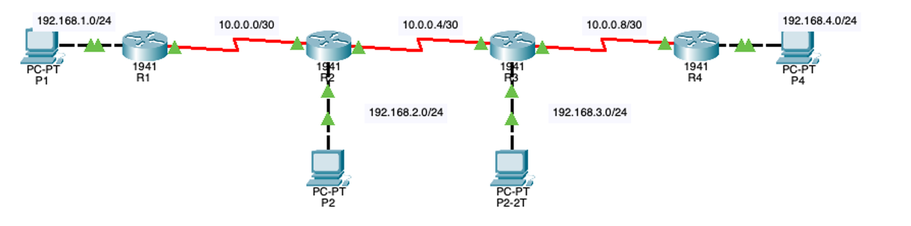

Министерство образования Республики Беларусь
Учреждение образования
«Брестский Государственный технический университет»
Кафедра ИИТ

**Лабораторная работа №6**
По дисциплине «Аппаратное и программное обеспечение сетей»
Тема: «Настройка динамической маршрутизации с помощью протокола RIP на устройствах Cisco»

**Выполнил:**
Студент 3 курса
Группы ИИ-28
Цибульскас В.С.

**Проверила:**
Прохорова С.С.

Брест 2026

---

**Цель работы:** Настроить динамическую маршрутизацию с помощью протокола RIP на маршрутизаторах и обеспечить взаимодействие конечных устройств между собой.

**Ход работы:**

**Вариант 2**

**НАЧАЛЬНАЯ ТОПОЛОГИЯ:**

Схема варианта 2 — цепочка из четырёх маршрутизаторов R1–R2–R3–R4, к каждому из которых подключена одна рабочая станция (P1, P2, P2-2T, P4). Маршрутизаторы соединены последовательными (serial) каналами, рабочие станции — кабелем crossover с интерфейсом Gi0/0 своего маршрутизатора. В качестве маршрутизаторов использована модель Cisco 1941 с установленным модулем HWIC-2T (два последовательных порта S0/0/0 и S0/0/1), как и в лабораторной работе №5.



*Рисунок 1 — Топология сети варианта 2 с адресами сетей.*

**ТАБЛИЦА ЗАПОЛНЕНИЯ**

| Устройство | Интерфейс | IP-адрес | Маска подсети | Шлюз по умолчанию | Куда подключен |
| :--- | :--- | :--- | :--- | :--- | :--- |
| P1 | FastEthernet0 | 192.168.1.10 | 255.255.255.0 | 192.168.1.1 | R1 (Gi0/0) |
| P2 | FastEthernet0 | 192.168.2.10 | 255.255.255.0 | 192.168.2.1 | R2 (Gi0/0) |
| P2-2T | FastEthernet0 | 192.168.3.10 | 255.255.255.0 | 192.168.3.1 | R3 (Gi0/0) |
| P4 | FastEthernet0 | 192.168.4.10 | 255.255.255.0 | 192.168.4.1 | R4 (Gi0/0) |
| R1 | Gi0/0 | 192.168.1.1 | 255.255.255.0 | N/A | P1 |
| R1 | Se0/0/0 | 10.0.0.1 | 255.255.255.252 | N/A | R2 (Se0/0/0) |
| R2 | Gi0/0 | 192.168.2.1 | 255.255.255.0 | N/A | P2 |
| R2 | Se0/0/0 | 10.0.0.2 | 255.255.255.252 | N/A | R1 (Se0/0/0) |
| R2 | Se0/0/1 | 10.0.0.5 | 255.255.255.252 | N/A | R3 (Se0/0/0) |
| R3 | Gi0/0 | 192.168.3.1 | 255.255.255.0 | N/A | P2-2T |
| R3 | Se0/0/0 | 10.0.0.6 | 255.255.255.252 | N/A | R2 (Se0/0/1) |
| R3 | Se0/0/1 | 10.0.0.9 | 255.255.255.252 | N/A | R4 (Se0/0/0) |
| R4 | Gi0/0 | 192.168.4.1 | 255.255.255.0 | N/A | P4 |
| R4 | Se0/0/0 | 10.0.0.10 | 255.255.255.252 | N/A | R3 (Se0/0/1) |

Локальным сетям выделены подсети /24 (255.255.255.0), межмаршрутизаторным каналам — /30 (255.255.255.252), то есть по два адреса на канал, как в примере из методички lab5-b.pdf.

Конфигурация конечных устройств (PC) проводилась вручную через окно IP Config.
Маршрутизаторы настраивались через CLI.

**Базовая настройка (пример для R1)**

```text
enable
configure terminal

no ip domain-lookup
hostname R1

interface GigabitEthernet0/0
ip address 192.168.1.1 255.255.255.0
no shutdown
exit

interface Serial0/0/0
ip address 10.0.0.1 255.255.255.252
clock rate 64000
no shutdown
exit

end
write
```

Аналогично настроены остальные маршрутизаторы: R2 — Gi0/0 192.168.2.1/24, Se0/0/0 10.0.0.2/30, Se0/0/1 10.0.0.5/30; R3 — Gi0/0 192.168.3.1/24, Se0/0/0 10.0.0.6/30, Se0/0/1 10.0.0.9/30; R4 — Gi0/0 192.168.4.1/24, Se0/0/0 10.0.0.10/30.

Команда `clock rate 64000` задаётся только на DCE-конце последовательного канала (со стороны тактового генератора): R1 Se0/0/0, R2 Se0/0/1, R3 Se0/0/1.

**Настройка RIP протокола**

Для R1:

```text
R1(config)#router rip
R1(config-router)#network 192.168.1.0
R1(config-router)#network 10.0.0.0
R1(config-router)#exit
```

Для R2:

```text
R2(config)#router rip
R2(config-router)#network 192.168.2.0
R2(config-router)#network 10.0.0.0
```

Для R3:

```text
R3(config)#router rip
R3(config-router)#network 192.168.3.0
R3(config-router)#network 10.0.0.0
```

Для R4:

```text
R4(config)#router rip
R4(config-router)#network 192.168.4.0
R4(config-router)#network 10.0.0.0
```

Командой `network` перечисляются только непосредственно подключённые к маршрутизатору сети: маршрутизатор сам определяет интерфейсы, участвующие в обмене маршрутной информацией, и анонсирует подключённые сети соседям. Сеть `10.0.0.0` — общая для всех последовательных каналов, поэтому указывается на каждом маршрутизаторе.

Настройки сохранены на всех устройствах командой `write memory` (`copy running-config startup-config`).

**ПРОВЕРКА КОНФИГУРАЦИИ:**

Проверка активности интерфейсов и адресов — `show ip interface brief`:

```text
R1#show ip interface brief
Interface              IP-Address      OK? Method Status                Protocol
GigabitEthernet0/0     192.168.1.1     YES manual up                    up
GigabitEthernet0/1     unassigned      YES NVRAM  administratively down down
Serial0/0/0            10.0.0.1        YES manual up                    up
Serial0/0/1            unassigned      YES unset  down                  down
Vlan1                  unassigned      YES NVRAM  administratively down down
```

```text
R2#show ip interface brief
Interface              IP-Address      OK? Method Status                Protocol
GigabitEthernet0/0     192.168.2.1     YES manual up                    up
GigabitEthernet0/1     unassigned      YES NVRAM  administratively down down
Serial0/0/0            10.0.0.2        YES manual up                    up
Serial0/0/1            10.0.0.5        YES manual up                    up
Vlan1                  unassigned      YES NVRAM  administratively down down
```

```text
R3#show ip interface brief
Interface              IP-Address      OK? Method Status                Protocol
GigabitEthernet0/0     192.168.3.1     YES manual up                    up
GigabitEthernet0/1     unassigned      YES NVRAM  administratively down down
Serial0/0/0            10.0.0.6        YES manual up                    up
Serial0/0/1            10.0.0.9        YES manual up                    up
Vlan1                  unassigned      YES NVRAM  administratively down down
```

```text
R4#show ip interface brief
Interface              IP-Address      OK? Method Status                Protocol
GigabitEthernet0/0     192.168.4.1     YES manual up                    up
GigabitEthernet0/1     unassigned      YES NVRAM  administratively down down
Serial0/0/0            10.0.0.10       YES manual up                    up
Serial0/0/1            unassigned      YES unset  down                  down
Vlan1                  unassigned      YES NVRAM  administratively down down
```

Параметры работы протокола — `show ip protocols`:

```text
R1#show ip protocols
Routing Protocol is "rip"
Sending updates every 30 seconds, next due in 2 seconds
Invalid after 180 seconds, hold down 180, flushed after 240
Outgoing update filter list for all interfaces is not set
Incoming update filter list for all interfaces is not set
Redistributing: rip
Default version control: send version 1, receive any version
  Interface             Send  Recv  Triggered RIP  Key-chain
  GigabitEthernet0/0    12 1
  Serial0/0/0           12 1
Automatic network summarization is in effect
Maximum path: 4
Routing for Networks:
        10.0.0.0
        192.168.1.0
Passive Interface(s):
Routing Information Sources:
        Gateway         Distance      Last Update
        10.0.0.2             120      00:00:26
Distance: (default is 120)
```

Протокол работает в версии 1 (по умолчанию), рассылает обновления каждые 30 с, административное расстояние RIP — 120. В списке источников — сосед R2 (10.0.0.2), от которого получены маршруты.

Таблицы маршрутизации — `show ip route`:

```text
R1#show ip route
Codes: L - local, C - connected, S - static, R - RIP, M - mobile, B - BGP
       D - EIGRP, EX - EIGRP external, O - OSPF, IA - OSPF inter area
       N1 - OSPF NSSA external type 1, N2 - OSPF NSSA external type 2
       E1 - OSPF external type 1, E2 - OSPF external type 2, E - EGP
       i - IS-IS, L1 - IS-IS level-1, L2 - IS-IS level-2, ia - IS-IS inter area
       * - candidate default, U - per-user static route, o - ODR
       P - periodic downloaded static route

Gateway of last resort is not set

     10.0.0.0/8 is variably subnetted, 4 subnets, 2 masks
C       10.0.0.0/30 is directly connected, Serial0/0/0
L       10.0.0.1/32 is directly connected, Serial0/0/0
R       10.0.0.4/30 [120/1] via 10.0.0.2, 00:00:23, Serial0/0/0
R       10.0.0.8/30 [120/2] via 10.0.0.2, 00:00:23, Serial0/0/0
     192.168.1.0/24 is variably subnetted, 2 subnets, 2 masks
C       192.168.1.0/24 is directly connected, GigabitEthernet0/0
L       192.168.1.1/32 is directly connected, GigabitEthernet0/0
R    192.168.2.0/24 [120/1] via 10.0.0.2, 00:00:23, Serial0/0/0
R    192.168.3.0/24 [120/2] via 10.0.0.2, 00:00:23, Serial0/0/0
R    192.168.4.0/24 [120/3] via 10.0.0.2, 00:00:23, Serial0/0/0
```

```text
R2#show ip route
Gateway of last resort is not set

     10.0.0.0/8 is variably subnetted, 5 subnets, 2 masks
C       10.0.0.0/30 is directly connected, Serial0/0/0
L       10.0.0.2/32 is directly connected, Serial0/0/0
C       10.0.0.4/30 is directly connected, Serial0/0/1
L       10.0.0.5/32 is directly connected, Serial0/0/1
R       10.0.0.8/30 [120/1] via 10.0.0.6, 00:00:23, Serial0/0/1
R    192.168.1.0/24 [120/1] via 10.0.0.1, 00:00:23, Serial0/0/0
     192.168.2.0/24 is variably subnetted, 2 subnets, 2 masks
C       192.168.2.0/24 is directly connected, GigabitEthernet0/0
L       192.168.2.1/32 is directly connected, GigabitEthernet0/0
R    192.168.3.0/24 [120/1] via 10.0.0.6, 00:00:23, Serial0/0/1
R    192.168.4.0/24 [120/2] via 10.0.0.6, 00:00:23, Serial0/0/1
```

```text
R3#show ip route
Gateway of last resort is not set

     10.0.0.0/8 is variably subnetted, 5 subnets, 2 masks
R       10.0.0.0/30 [120/1] via 10.0.0.5, 00:00:23, Serial0/0/0
C       10.0.0.4/30 is directly connected, Serial0/0/0
L       10.0.0.6/32 is directly connected, Serial0/0/0
C       10.0.0.8/30 is directly connected, Serial0/0/1
L       10.0.0.9/32 is directly connected, Serial0/0/1
R    192.168.1.0/24 [120/2] via 10.0.0.5, 00:00:23, Serial0/0/0
R    192.168.2.0/24 [120/1] via 10.0.0.5, 00:00:23, Serial0/0/0
     192.168.3.0/24 is variably subnetted, 2 subnets, 2 masks
C       192.168.3.0/24 is directly connected, GigabitEthernet0/0
L       192.168.3.1/32 is directly connected, GigabitEthernet0/0
R    192.168.4.0/24 [120/1] via 10.0.0.10, 00:00:28, Serial0/0/1
```

```text
R4#show ip route
Gateway of last resort is not set

     10.0.0.0/8 is variably subnetted, 4 subnets, 2 masks
R       10.0.0.0/30 [120/2] via 10.0.0.9, 00:00:23, Serial0/0/0
R       10.0.0.4/30 [120/1] via 10.0.0.9, 00:00:23, Serial0/0/0
C       10.0.0.8/30 is directly connected, Serial0/0/0
L       10.0.0.10/32 is directly connected, Serial0/0/0
R    192.168.1.0/24 [120/3] via 10.0.0.9, 00:00:23, Serial0/0/0
R    192.168.2.0/24 [120/2] via 10.0.0.9, 00:00:23, Serial0/0/0
R    192.168.3.0/24 [120/1] via 10.0.0.9, 00:00:23, Serial0/0/0
     192.168.4.0/24 is variably subnetted, 2 subnets, 2 masks
C       192.168.4.0/24 is directly connected, GigabitEthernet0/0
L       192.168.4.1/32 is directly connected, GigabitEthernet0/0
```

Обозначение `C` — непосредственно подключённая сеть, `L` — адрес самого интерфейса, `R` — маршрут, полученный по протоколу RIP. Каждый маршрутизатор знает все семь сетей варианта: четыре локальные (192.168.1.0–192.168.4.0) и три межмаршрутизаторные (10.0.0.0/30, 10.0.0.4/30, 10.0.0.8/30). В квадратных скобках указаны административное расстояние и метрика (число пройденных маршрутизаторов): например, у R1 сеть 192.168.2.0/24 имеет метрику 1, 192.168.3.0/24 — 2, 192.168.4.0/24 — 3.

**ПИНГ:**

P1 – P4 (через четыре маршрутизатора):

```text
C:\>ping 192.168.4.10
Pinging 192.168.4.10 with 32 bytes of data:

Reply from 192.168.4.10: bytes=32 time=44ms TTL=124
Reply from 192.168.4.10: bytes=32 time=37ms TTL=124
Reply from 192.168.4.10: bytes=32 time=39ms TTL=124
Reply from 192.168.4.10: bytes=32 time=45ms TTL=124

Ping statistics for 192.168.4.10:
    Packets: Sent = 4, Received = 4, Lost = 0 (0% loss),
Approximate round trip times in milli-seconds:
    Minimum = 37ms, Maximum = 45ms, Average = 41ms
```

P4 – P1 (обратное направление):

```text
C:\>ping 192.168.1.10
Pinging 192.168.1.10 with 32 bytes of data:

Reply from 192.168.1.10: bytes=32 time=32ms TTL=124
Reply from 192.168.1.10: bytes=32 time=38ms TTL=124
Reply from 192.168.1.10: bytes=32 time=27ms TTL=124
Reply from 192.168.1.10: bytes=32 time=42ms TTL=124

Ping statistics for 192.168.1.10:
    Packets: Sent = 4, Received = 4, Lost = 0 (0% loss),
Approximate round trip times in milli-seconds:
    Minimum = 27ms, Maximum = 42ms, Average = 34ms
```

P2 – P2-2T (через R2 и R3):

```text
C:\>ping 192.168.3.10
Pinging 192.168.3.10 with 32 bytes of data:

Reply from 192.168.3.10: bytes=32 time=14ms TTL=126
Reply from 192.168.3.10: bytes=32 time=21ms TTL=126
Reply from 192.168.3.10: bytes=32 time=14ms TTL=126
Reply from 192.168.3.10: bytes=32 time=19ms TTL=126

Ping statistics for 192.168.3.10:
    Packets: Sent = 4, Received = 4, Lost = 0 (0% loss),
Approximate round trip times in milli-seconds:
    Minimum = 14ms, Maximum = 21ms, Average = 17ms
```

P1 – P2 (через R1 и R2):

```text
C:\>ping 192.168.2.10
Pinging 192.168.2.10 with 32 bytes of data:

Reply from 192.168.2.10: bytes=32 time=12ms TTL=126
Reply from 192.168.2.10: bytes=32 time=21ms TTL=126
Reply from 192.168.2.10: bytes=32 time=15ms TTL=126
Reply from 192.168.2.10: bytes=32 time=14ms TTL=126

Ping statistics for 192.168.2.10:
    Packets: Sent = 4, Received = 4, Lost = 0 (0% loss),
Approximate round trip times in milli-seconds:
    Minimum = 12ms, Maximum = 21ms, Average = 15ms
```

**Вывод:** В ходе лабораторной работы была собрана сеть из четырёх маршрутизаторов Cisco 1941 по варианту 2 (цепочка R1–R2–R3–R4 с четырьмя рабочими станциями P1, P2, P2-2T, P4), настроена IP-адресация интерфейсов и динамическая маршрутизация по протоколу RIP. Команда `show ip protocols` подтвердила, что протокол RIP активен, рассылает обновления каждые 30 секунд и анонсирует подключённые сети; команда `show ip route` показала, что каждый маршрутизатор автоматически получил маршруты ко всем семи сетям схемы с метриками, равными числу пройденных маршрутизаторов. Утилита `ping` подтвердила связность всех конечных устройств в обоих направлениях без потерь; значения TTL (126 при двух транзитных маршрутизаторах и 124 при четырёх) соответствуют числу пройденных маршрутизаторов. Маршруты, заданные вручную (статические), при этом не использовались — вся маршрутная информация получена динамически.
