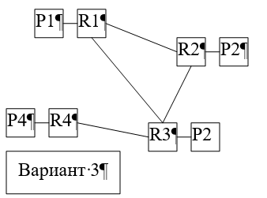
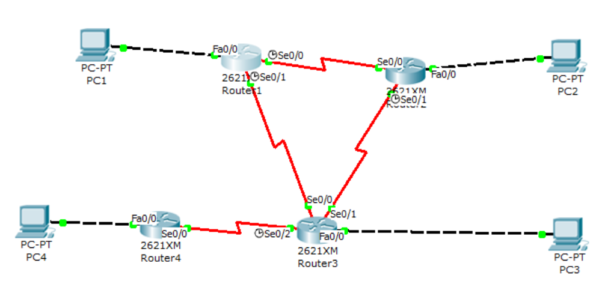
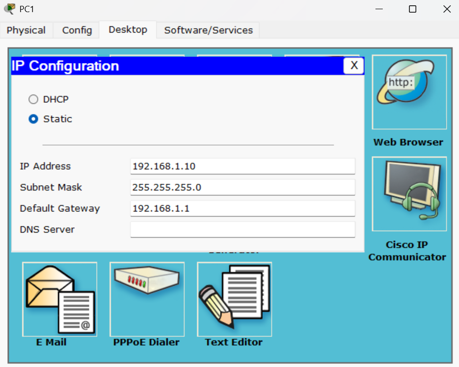
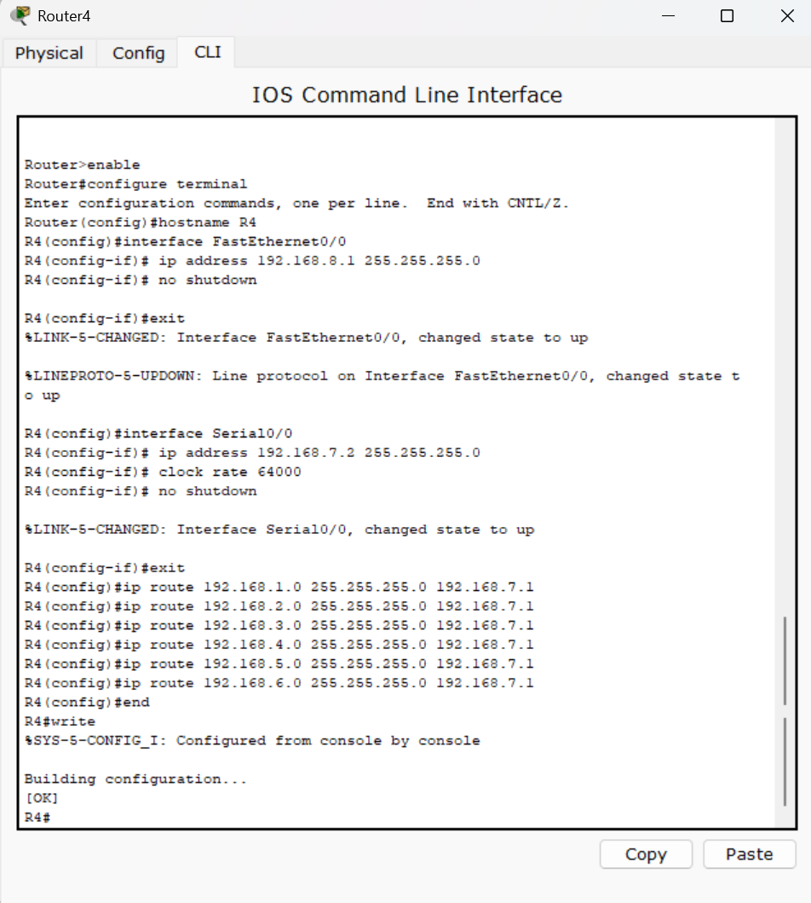
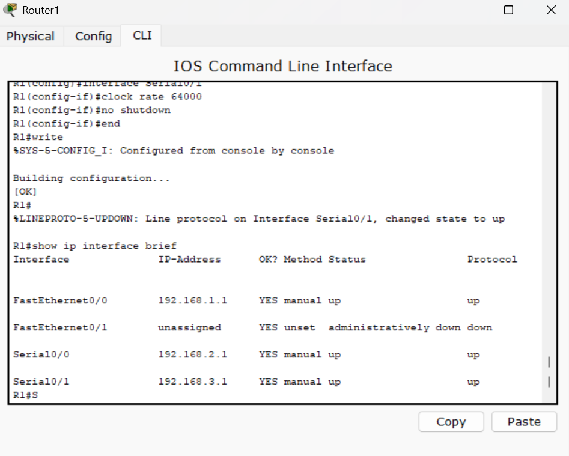
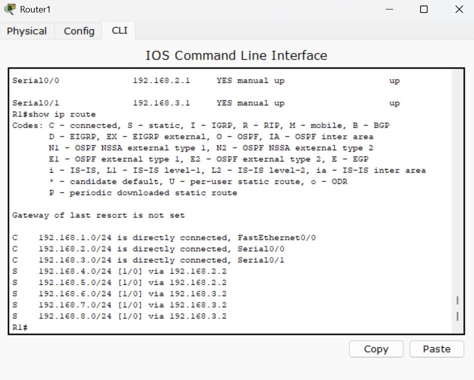
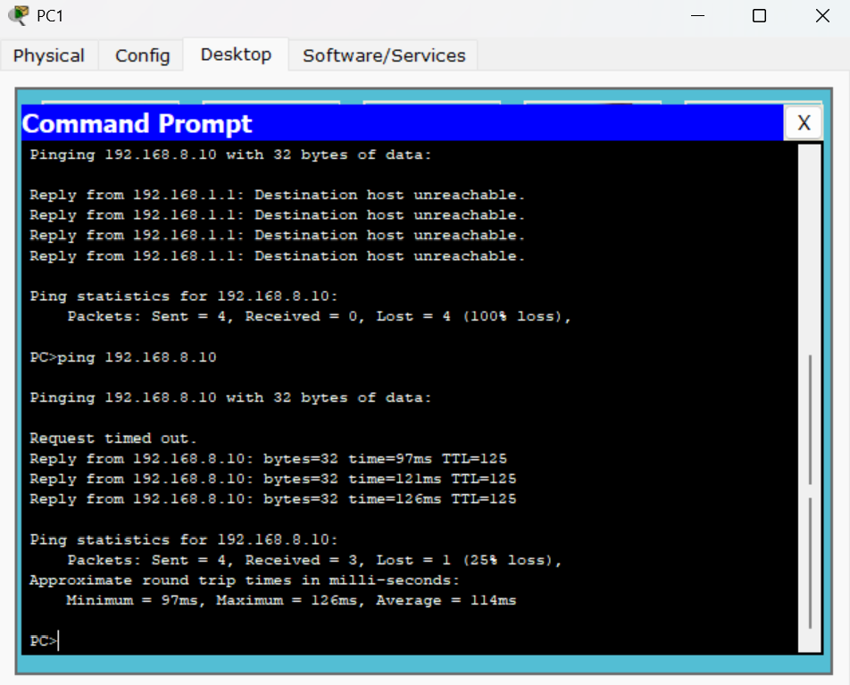
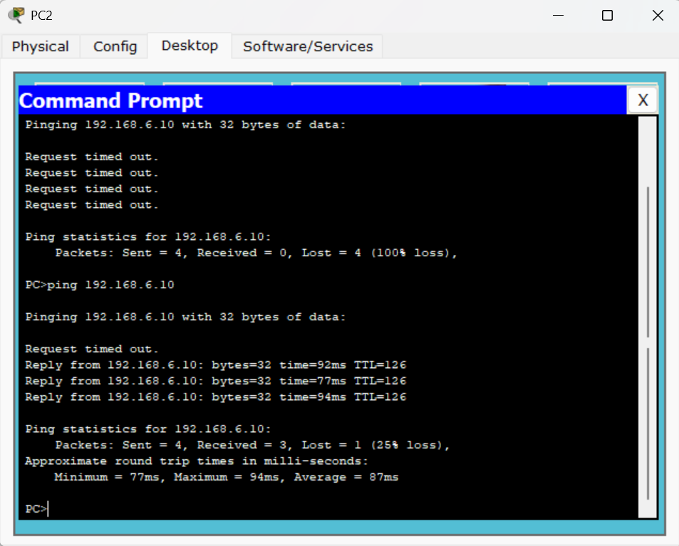
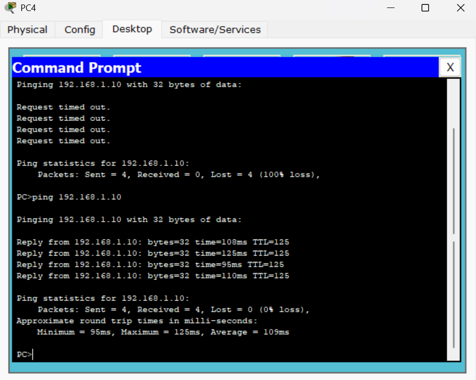

# ЛАБОРАТОРНАЯ РАБОТА 5
**Настройка статической маршрутизации на устройствах Cisco**
**Вариант 3**

---

## 1. Схема сети с IP-адресами

Топология сети (Вариант 3):

Соединения:
- P1 ↔ R1 (FastEthernet, Copper Cross-Over)
- P2 ↔ R2 (FastEthernet, Copper Cross-Over)
- P3 ↔ R3 (FastEthernet, Copper Cross-Over)
- P4 ↔ R4 (FastEthernet, Copper Cross-Over)
- R1 ↔ R2 (Serial, Serial DCE/DTE)
- R1 ↔ R3 (Serial, Serial DCE/DTE)
- R2 ↔ R3 (Serial, Serial DCE/DTE)
- R3 ↔ R4 (Serial, Serial DCE/DTE)


---

## 2. Таблица IP-адресов

| Устройство | Интерфейс | IP-адрес | Маска подсети | Шлюз по умолчанию | Роль |
|---|---|---|---|---|---|
| P1 | NIC | 192.168.1.10 | 255.255.255.0 | 192.168.1.1 | Конечный узел |
| R1 | FastEthernet0/0 | 192.168.1.1 | 255.255.255.0 | — | Шлюз P1 |
| R1 | Serial0/0 | 192.168.2.1 | 255.255.255.0 | — | Связь с R2 (DTE) |
| R1 | Serial0/1 | 192.168.3.1 | 255.255.255.0 | — | Связь с R3 (DTE) |
| R2 | Serial0/0 | 192.168.2.2 | 255.255.255.0 | — | Связь с R1 (DCE) |
| R2 | Serial0/1 | 192.168.4.1 | 255.255.255.0 | — | Связь с R3 (DTE) |
| R2 | FastEthernet0/0 | 192.168.5.1 | 255.255.255.0 | — | Шлюз P2 |
| P2 | NIC | 192.168.5.10 | 255.255.255.0 | 192.168.5.1 | Конечный узел |
| R3 | Serial0/0 | 192.168.3.2 | 255.255.255.0 | — | Связь с R1 (DCE) |
| R3 | Serial0/1 | 192.168.4.2 | 255.255.255.0 | — | Связь с R2 (DCE) |
| R3 | Serial0/2 | 192.168.7.1 | 255.255.255.0 | — | Связь с R4 (DTE) |
| R3 | FastEthernet0/0 | 192.168.6.1 | 255.255.255.0 | — | Шлюз P3 |
| P3 | NIC | 192.168.6.10 | 255.255.255.0 | 192.168.6.1 | Конечный узел |
| R4 | Serial0/0 | 192.168.7.2 | 255.255.255.0 | — | Связь с R3 (DCE) |
| R4 | FastEthernet0/0 | 192.168.8.1 | 255.255.255.0 | — | Шлюз P4 |
| P4 | NIC | 192.168.8.10 | 255.255.255.0 | 192.168.8.1 | Конечный узел |

---

## 3. Ход настройки статической маршрутизации

### 3.1. Настройка IP-адресов на конечных узлах

**P1:**
- IP: 192.168.1.10
- Маска: 255.255.255.0
- Шлюз: 192.168.1.1

**P2:**
- IP: 192.168.5.10
- Маска: 255.255.255.0
- Шлюз: 192.168.5.1

**P3:**
- IP: 192.168.6.10
- Маска: 255.255.255.0
- Шлюз: 192.168.6.1

**P4:**
- IP: 192.168.8.10
- Маска: 255.255.255.0
- Шлюз: 192.168.8.1



### 3.2. Настройка маршрутизатора R1

```
enable
configure terminal
hostname R1
interface FastEthernet0/0
 ip address 192.168.1.1 255.255.255.0
 no shutdown
 exit
interface Serial0/0/0
 ip address 192.168.2.1 255.255.255.0
 no shutdown
 exit
interface Serial0/0/1
 ip address 192.168.3.1 255.255.255.0
 no shutdown
 exit
ip route 192.168.4.0 255.255.255.0 192.168.2.2
ip route 192.168.5.0 255.255.255.0 192.168.2.2
ip route 192.168.6.0 255.255.255.0 192.168.3.2
ip route 192.168.7.0 255.255.255.0 192.168.3.2
ip route 192.168.8.0 255.255.255.0 192.168.3.2
end
write
```

### 3.3. Настройка маршрутизатора R2

```
enable
configure terminal
hostname R2
interface FastEthernet0/0
 ip address 192.168.5.1 255.255.255.0
 no shutdown
 exit
interface Serial0/0/0
 ip address 192.168.2.2 255.255.255.0
 clock rate 64000
 no shutdown
 exit
interface Serial0/0/1
 ip address 192.168.4.1 255.255.255.0
 no shutdown
 exit
ip route 192.168.1.0 255.255.255.0 192.168.2.1
ip route 192.168.3.0 255.255.255.0 192.168.2.1
ip route 192.168.6.0 255.255.255.0 192.168.4.2
ip route 192.168.7.0 255.255.255.0 192.168.4.2
ip route 192.168.8.0 255.255.255.0 192.168.4.2
end
write
```

### 3.4. Настройка маршрутизатора R3

```
enable
configure terminal
hostname R3
interface FastEthernet0/0
 ip address 192.168.6.1 255.255.255.0
 no shutdown
 exit
interface Serial0/0/0
 ip address 192.168.3.2 255.255.255.0
 clock rate 64000
 no shutdown
 exit
interface Serial0/0/1
 ip address 192.168.4.2 255.255.255.0
 clock rate 64000
 no shutdown
 exit
interface Serial0/1/0
 ip address 192.168.7.1 255.255.255.0
 no shutdown
 exit
ip route 192.168.1.0 255.255.255.0 192.168.3.1
ip route 192.168.2.0 255.255.255.0 192.168.3.1
ip route 192.168.5.0 255.255.255.0 192.168.4.1
ip route 192.168.8.0 255.255.255.0 192.168.7.2
end
write
```

### 3.5. Настройка маршрутизатора R4

```
enable
configure terminal
hostname R4
interface FastEthernet0/0
 ip address 192.168.8.1 255.255.255.0
 no shutdown
 exit
interface Serial0/0/0
 ip address 192.168.7.2 255.255.255.0
 clock rate 64000
 no shutdown
 exit
ip route 0.0.0.0 0.0.0.0 192.168.7.1
end
write
```



---

## 4. Ход и результаты проверки и тестирования сети

### 4.1. Проверка статуса интерфейсов

**Команда:** `show ip interface brief`

**R1:**
```
R1#show ip interface brief
Interface              IP-Address      OK? Method Status                Protocol
FastEthernet0/0        192.168.1.1     YES manual up                    up
FastEthernet0/1        unassigned      YES unset  administratively down down
Serial0/0/0            192.168.2.1     YES manual up                    up
Serial0/0/1            192.168.3.1     YES manual up                    up
```

**R2:**
```
R2#show ip interface brief
Interface              IP-Address      OK? Method Status                Protocol
FastEthernet0/0        192.168.5.1     YES manual up                    up
FastEthernet0/1        unassigned      YES unset  administratively down down
Serial0/0/0            192.168.2.2     YES manual up                    up
Serial0/0/1            192.168.4.1     YES manual up                    up
```

**R3:**
```
R3#show ip interface brief
Interface              IP-Address      OK? Method Status                Protocol
FastEthernet0/0        192.168.6.1     YES manual up                    up
FastEthernet0/1        unassigned      YES unset  administratively down down
Serial0/0/0            192.168.3.2     YES manual up                    up
Serial0/0/1            192.168.4.2     YES manual up                    up
Serial0/1/0            192.168.7.1     YES manual up                    up
```

**R4:**
```
R4#show ip interface brief
Interface              IP-Address      OK? Method Status                Protocol
FastEthernet0/0        192.168.8.1     YES manual up                    up
FastEthernet0/1        unassigned      YES unset  administratively down down
Serial0/0/0            192.168.7.2     YES manual up                    up
```



**Разъяснение:** Статус `up/up` для всех задействованных интерфейсов означает, что интерфейсы физически включены (`no shutdown`) и канальный протокол активен. Интерфейсы FastEthernet0/1 на всех маршрутизаторах находятся в состоянии `administratively down`, так как не используются в данной топологии.

### 4.2. Проверка таблиц маршрутизации

**Команда:** `show ip route`

**R1:**
```
R1#show ip route
Codes: C - connected, S - static, R - RIP, M - mobile, B - BGP
       D - EIGRP, EX - EIGRP external, O - OSPF, IA - OSPF inter area
       N1 - OSPF NSSA external type 1, N2 - OSPF NSSA external type 2
       E1 - OSPF external type 1, E2 - OSPF external type 2
       i - IS-IS, su - IS-IS summary, L1 - IS-IS level-1, L2 - IS-IS level-2
       ia - IS-IS inter area, * - candidate default, U - per-user static route
       o - ODR, P - periodic downloaded static route, H - NHRP, l - LISP
       a - application route
       + - replicated route, % - next hop override, p - overrides from PfR

Gateway of last resort is not set

C    192.168.1.0/24 is directly connected, FastEthernet0/0
C    192.168.2.0/24 is directly connected, Serial0/0/0
C    192.168.3.0/24 is directly connected, Serial0/0/1
S    192.168.4.0/24 [1/0] via 192.168.2.2
S    192.168.5.0/24 [1/0] via 192.168.2.2
S    192.168.6.0/24 [1/0] via 192.168.3.2
S    192.168.7.0/24 [1/0] via 192.168.3.2
S    192.168.8.0/24 [1/0] via 192.168.3.2
```

**R4:**
```
R4#show ip route
Codes: C - connected, S - static, R - RIP, M - mobile, B - BGP
       D - EIGRP, EX - EIGRP external, O - OSPF, IA - OSPF inter area
       N1 - OSPF NSSA external type 1, N2 - OSPF NSSA external type 2
       E1 - OSPF external type 1, E2 - OSPF external type 2
       i - IS-IS, su - IS-IS summary, L1 - IS-IS level-1, L2 - IS-IS level-2
       ia - IS-IS inter area, * - candidate default, U - per-user static route
       o - ODR, P - periodic downloaded static route, H - NHRP, l - LISP
       a - application route
       + - replicated route, % - next hop override, p - overrides from PfR

Gateway of last resort is 192.168.7.1 to network 0.0.0.0

S*   0.0.0.0/0 [1/0] via 192.168.7.1
C    192.168.7.0/24 is directly connected, Serial0/0/0
C    192.168.8.0/24 is directly connected, FastEthernet0/0
```



**Разъяснение:** 
- Буква **C** (connected) обозначает сети, непосредственно подключенные к интерфейсам маршрутизатора.
- Буква **S** (static) обозначает статические маршруты, настроенные вручную.
- На R4 виден маршрут по умолчанию **S\*** (candidate default), указывающий на шлюз 192.168.7.1 (R3), что позволяет R4 достигать все удаленные сети через единственный путь.

### 4.3. Тестирование связности (ping между конечными узлами)

**Тест 1: P1 → P4 (путь: P1→R1→R3→R4→P4)**


**Тест 2: P2 → P3 (путь: P2→R2→R3→P3)**
`

**Тест 3: P4 → P1 (путь: P4→R4→R3→R1→P1)**


**Разъяснение результатов:**

1. **Первый Request timed out при P1→P4:** Это нормальное явление. Первый пакет теряется, так как маршрутизаторы и конечные узлы должны выполнить ARP-запросы для разрешения MAC-адресов шлюзов. После построения ARP-таблиц последующие пакеты доставляются успешно.

2. **Значение TTL:** 
   - При P1→P4: TTL=125 (начальное значение 128 минус 3 хопа: R1→R3→R4)
   - При P2→P3: TTL=127 (начальное значение 128 минус 1 хоп: R2→R3)
   - При P4→P1: TTL=125 (начальное значение 128 минус 3 хопа: R4→R3→R1)
   
   Уменьшение TTL на 1 на каждом маршрутизаторе подтверждает, что пакеты проходят через цепочку маршрутизаторов, а не передаются в пределах одной локальной сети.

3. **0% потерь на P4→P1:** Статические маршруты настроены корректно в обоих направлениях (прямой и обратный пути существуют).

4. **Время отклика <1ms:** Минимальная задержка подтверждает, что все устройства находятся в локальной simulated среде без реальных сетевых задержек.

---

## 5. Вывод

В ходе выполнения лабораторной работы была собрана топология сети согласно Варианту 3, состоящая из 4 маршрутизаторов (R1, R2, R3, R4) и 4 конечных узлов (P1, P2, P3, P4). На всех устройствах настроены IP-адреса и маска подсети 255.255.255.0.

На маршрутизаторах настроена статическая маршрутизация с использованием команды `ip route`. Для маршрутизатора R4, имеющего только один путь к остальной сети, использован маршрут по умолчанию (`ip route 0.0.0.0 0.0.0.0 192.168.7.1`).

Тестирование связности с помощью утилиты `ping` подтвердило корректность настройки: пакеты успешно доставляются между всеми конечными узлами сети. Первый пакет при пинге по длинному маршруту теряется из-за ARP-разрешения, что является нормальным поведением. Значения TTL подтверждают прохождение пакетов через несколько маршрутизаторов.

Все интерфейсы маршрутизаторов находятся в состоянии `up/up`, что свидетельствует о физической и канальной работоспособности соединений. Таблицы маршрутизации содержат как непосредственно подключенные сети (C), так и статические маршруты (S).

